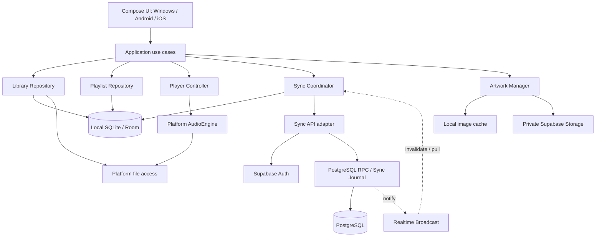
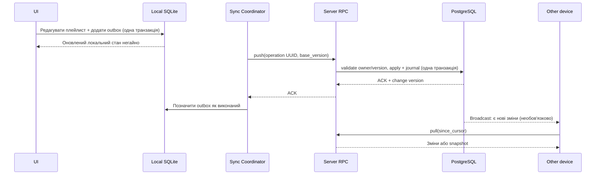

# Music Player — Architecture v1.0

> **Узгодження 18.11.2026:** поточна назва — Ritorn; історичні заголовки та назви файлів збережено. Статуси й джерела рішень — у [DECISIONS.md](DECISIONS.md). P0/P1 означають пріоритет, не затвердження технології. Стек і контракти залишаються пропозиціями до рев’ю/PoC.

**Дата:** 14 листопада 2026 року  
**Статус:** проєкт архітектури для погодження, не реалізовано  
**Основа:** `Music_Player_PRD_v1.0.md` від 13.11.2026  
**Платформи:** Windows, Android, iOS  
**Головна мета:** швидкий локальний музичний плеєр, у якому синхронізація метаданих не заважає відтворенню.

> **Примітка до статусів:** «Погоджено» означає раніше узгоджену поведінку продукту; «Рекомендовано» — архітектурний вибір, який ще можна змінити; «PoC» — рішення, що потребує перевірки прототипом. Цей документ не стверджує, що код, інтеграції або тести вже виконано.

## 1. Архітектурні принципи

1. **Local-first.** Аудіофайли, локальні плейлисти, черга й індекс бібліотеки доступні без сервера.
2. **Offline-first sync.** Зміна синхронізованих об'єктів записується локально разом із операцією до outbox; відправляється пізніше.
3. **Відтворення ізольоване від мережі.** `AudioEngine` не чекає Supabase, не читає хмарну БД і не потребує логіна.
4. **Надійна ідентичність.** Локальний файл, локальна композиція, синхронізована композиція і входження до плейлиста — окремі сутності та ID.
5. **Недеструктивність.** Жодна операція синхронізації чи зіставлення не модифікує і не видаляє фізичний аудіофайл.
6. **Консервативне зіставлення.** Назва файлу чи теги самі по собі не є доказом ідентичності аудіо.
7. **Безпека на межах.** Дозволи ОС, формат медіа, авторизація, доступ до рядків БД і завантаження обкладинок перевіряються там, де дані перетинають межі довіри.
8. **Мінімальна складність.** Один клієнтський KMP-проєкт із логічними модулями; сервер — Supabase/PostgreSQL з невеликою кількістю атомарних RPC. Мікросервіси не потрібні для MVP.

## 2. Технологічні кандидати

| Шар | Рекомендація | Статус / застереження |
| --- | --- | --- |
| Мова й спільний код | Kotlin Multiplatform | Рекомендовано |
| UI | Compose Multiplatform | Рекомендовано; Windows/JVM виміряти RAM і холодний запуск |
| Локальна БД | Room KMP + `BundledSQLiteDriver` | Рекомендовано; перевірити міграції/FTS на трьох платформах |
| Android audio | Media3 / ExoPlayer + MediaSessionService | Основний кандидат, PoC |
| iOS audio | AVFoundation, AVAudioEngine за потреби DSP | Кандидат, особливо перевірити FLAC/seek/background |
| Windows audio | libmpv через невеликий native adapter | Кандидат; PoC JNI/JNA/FFM, пакування, ліцензії, альтернативно LibVLC |
| Auth/Cloud DB | Supabase Auth + PostgreSQL | Рекомендовано для прототипу/бети |
| Клієнт API | supabase-kt або вузький HTTP-адаптер | PoC: `supabase-kt` підтримується спільнотою, не офіційно Supabase |
| Синхронізація | Свій протокол push/pull + outbox + journal | Needs PoC; технічна пропозиція |
| Online сповіщення | Supabase Realtime Broadcast | Оптимізація, не механізм гарантованої доставки |
| Хмарні обкладинки | Приватний Supabase Storage | Рекомендовано; аудіофайли не зберігаються |

**Не вирішувати передчасно:** точні версії Kotlin/Compose/Room, механізм native bridge Windows, аудіоформати понад MP3/FLAC/AAC-M4A, DSP, підтримку bit-perfect. Фіксувати їх після PoC із матрицею сумісності й ліцензій.

## 3. Схема на високому рівні



**Потоки в схемі:** UI викликає use cases, а не спілкується з БД напряму. Плеєр дістає лише перевірений доступний локальний файл. Sync Engine змінює локальну репліку і не керує аудіопотоком.

## 4. Клієнтські логічні модулі

| Модуль | Відповідальність | Чого він не робить |
| --- | --- | --- |
| `ui` | Екрани, адаптивна навігація, стан списків, сповіщення | Не виконує SQL і не декодує аудіо |
| `domain` | Use cases, правила SYNC/TRACK, моделі, інтерфейси | Не залежить від Android/iOS/Windows API |
| `library` | Сканування, індексація, пошук, стан доступності файлів | Не змінює фізичні аудіо без окремої функції |
| `playlists` | Створення, перестановка, дублювання, кошик, експорт | Не видаляє файл при видаленні елемента |
| `player` | Черга, shuffle/repeat, restore, керування `AudioEngine` | Не звертається до хмарної БД |
| `matching` | Точні зв'язки, кандидатні відповідності, ручне підтвердження | Не поєднує записи лише за назвою |
| `sync` | Outbox, push/pull, ідемпотентність, конфлікти, курсори | Не вважає Realtime джерелом істини |
| `artwork` | Витяг, кеш, мініатюри, опціональна хмарна копія | Не тримає великі оригінали в SQLite |
| `platform` | Аудіо, файлові URI/permissions, захищені токени, фонові задачі | Не містить продуктових правил синхронізації |

**Рекомендація до структури Gradle:** не створювати по Gradle-модулю на кожну таблицю чи сервіс. Почати з `shared` (пакети за функціями) та трьох точок входу; виділяти самостійні модулі лише після появи залежностей і виміряних потреб.

Приблизний каркас:

```text
Ritorn/
  androidApp/
  iosApp/
  desktopApp/
  shared/
    src/commonMain/kotlin/
      domain/  library/  playlists/  player/  matching/  sync/  artwork/
    src/androidMain/kotlin/
    src/iosMain/kotlin/
    src/desktopMain/kotlin/
  backend/
    supabase/migrations/
    supabase/tests/
  docs/
    Music_Player_PRD_v1.0.md
    ARCHITECTURE_v1.0.md
    DECISIONS.md
    DATA_MODEL_v1.0.md
    SYNC_SPEC_v1.0.md
  tests/
```

Це лише шаблон організації; конкретні source sets і package names визначимо під час створення KMP-проєкту.

## 5. AudioEngine: контракт і платформи

Запропонований спільний контракт (до PoC): `load(localMediaHandle)`, `play`, `pause`, `seekTo`, `setQueue`, `skipNext`, `skipPrevious`, `setRepeatMode`, `setShuffle`, `observeState`, `dispose`.

- **Android:** Media3 / ExoPlayer, медіасесія живе в `MediaSessionService`, а не всередині composable-екрана. Переривання і навушники обробляє платформна реалізація.
- **iOS:** вибір між простим playback та графом `AVAudioEngine` залежить від результатів тестів FLAC, gapless і майбутнього EQ; аудіосесія і фоновий режим — платформна частина.
- **Windows:** libmpv із малим native bridge; перевірити керування, runtime bundle, RAM, системні медіакнопки, ліцензування. Якщо інтеграція невиправдано складна — LibVLC або інший backend.
- **Підготовка медіа:** `PlayerController` викликає `LocalMediaResolver`, який перевіряє прив'язку й доступність локального ресурсу. Якщо підтвердженого файлу немає — показує недоступність і не підміняє його за схожою назвою.
- **Відновлення:** збережені черга й позиція відновлюються локально; автозапуск без дії користувача заборонено.
- **Продуктивність:** аудіо не проходить через Compose; файли читаються потоково; обчислення хешів та зображень не працюють на аудіопотоці.

### 5.1 Playback Statistics Collector

**Статус:** ранній локальний збір — Approved (STAT-01); цей компонент, інтерфейс і політика збереження — Proposed (STAT-TECH-01).

`PlayerController` публікує зміни фактичного стану через явний інтерфейс `PlaybackEventSource`; `PlaybackStatisticsCollector` споживає їх асинхронно й записує історію через локальний `PlaybackHistoryStore`. Це логічні межі для тестування, а не вимога створити окремі Gradle-модулі. Collector не залежить від Supabase, Auth, Sync Coordinator чи серверних ID.

- Інтерфейс має передавати стабільну локальну ідентичність запису/сесії та достатню інформацію про pause, resume, seek, skip, completion і системні переривання. Команда play сама по собі не доводить фактичного прослуховування. Точні типи подій, payload, межі сесії та часові одиниці ще не затверджені.
- Обробка й локальний I/O відбуваються поза аудіопотоком та головним UI-потоком; обмежити буфер, паралелізм і витрати CPU/пам’яті. Політику переповнення/об’єднання подій та обробку помилки сховища перевірити в PoC: не блокувати playback і не видавати втрачені дані за точні.
- Pause/resume і seek не можна трактувати як простий приріст позиції; seek не є прослуханим часом. Skip і completion зберігають контекст завершення, але пороги метрик потребують погодження. Джерело часу та обробка зміни годинника — відкритий дизайн.
- Не покладатися лише на callback завершення: запропонувати durable checkpoints і відновлення незавершених сесій після crash. Повтор recovery не дублює історію, не вигадує незбережений час чи completion і не запускає аудіо. Частота checkpoint та допустиме вікно втрати — відкриті.
- Історія переживає зникнення файлу, зміну шляху й sync snapshot; локальна recording identity не замінюється filename або cloud ID. Зберігати ізоляцію scope; перенесення guest/account історії потребує продуктового рішення.
- Тестувати через підставні джерело подій, годинник і сховище: pause/resume/seek, повтори, завершення/skip, crash між записами, restart, disk failure та bounded queue pressure. Критерії — PRD STAT-AC-01–06.

Модель збереження — [Data Model](DATA_MODEL_v1.0.md) §4.12. Повна аналітична панель і статистична синхронізація не є умовою раннього збору.

## 6. FileAccess і сканування медіа

Контракт `MediaSource`: `listEntries`, `openRead`, `getStableLocator`, `getMetadata`, `requestAccess`, `revalidateAccess`.

- **Windows:** доступ до вибраних папок/дисків, поступове індексування, контроль відключених носіїв і символічних посилань.
- **Android:** MediaStore для загальної медіатеки, SAF/URI для вибраних папок, дозволи відповідно до версії ОС.
- **iOS:** Document Picker та security-scoped URL/bookmarks, контроль втрати дозволів.
- **Кеш індексу:** статус, розмір, час зміни, локальний locator і результат валідації. Це оптимізація, не гарантія незмінності байтів; при підозрі на заміну файлу або перед відтворенням виконуються потрібні перевірки.
- **Пошкоджений або підмінений файл:** відхилити як валідний аудіозапис, не видаляючи оригінал; помилка одного файлу не зупиняє індексацію.

## 7. Концептуальна модель даних

### 7.1 Локальна SQLite (окрема область даних гостя/акаунта)

| Сутність | Основні поля / призначення |
| --- | --- |
| `local_tracks` | `local_track_id`, `scope_id`, title/artist/album/duration; запис локальної бібліотеки |
| `audio_files` | `file_id`, `local_track_id`, `locator`, `format`, `codec`, `size`, `mtime`, `hash?`, `availability` |
| `track_links` | `local_track_id`, `synced_track_id`, `verification_method`, `confirmed_at?` |
| `playlists` | `local_playlist_id`, `cloud_playlist_id?`, `scope_id`, `kind`, `name`, `deleted_at?` |
| `playlist_items` | `item_id`, `playlist_id`, `local_track_id?`, `synced_track_id?`, `order_key` |
| `artwork_cache` | `artwork_id`, `hash`, `cache_path`, dimensions/version, accessed_at |
| `sync_outbox` | `operation_id`, kind/payload, base_version, status/retry_count; записується в тій самій транзакції, що й локальна зміна |
| `sync_cursor` | `account_id`, last_applied_change_version, sync_status |
| `playback_state` | device-local queue, position, repeat/shuffle |
| `playback_sessions` (Proposed) | Локальна історія зі стабільною recording/session identity; окремо від restore state; не синхронізувати |
| `access_grants` | внутрішній locator/bookmark/URI permissions, **не синхронізувати** |

`scope_id` відділяє гостьову бібліотеку й дані акаунтів на одному пристрої. Для доступу до аудіо після logout можна окремо вирішити, чи дозволено показувати локальну загальну бібліотеку; хмарні дані попереднього акаунта не можна віддавати іншому.

### 7.2 PostgreSQL/Supabase

| Сутність | Основні поля / призначення |
| --- | --- |
| `profiles` | `user_id` з Supabase Auth, параметри профілю |
| `devices` | `device_id`, `user_id`, name/last_seen, поточні інсталяції |
| `synced_tracks` | `track_id UUID`, `user_id`, метадані, `catalog_active`, `removed_at?` |
| `playlists` | `playlist_id UUID`, `user_id`, name, version, `deleted_at?` |
| `playlist_items` | `item_id UUID`, `playlist_id`, `track_id`, `order_key`, version |
| `artwork_assets` | `artwork_id`, `user_id`, storage_key, content_hash, version |
| `processed_operations` | `user_id`, `operation_id UNIQUE per user`, outcome/result; захист від повторів |
| `account_change_counter` | `user_id`, `last_version`; транзакційне впорядкування змін одного акаунта |
| `change_log` | `user_id`, `change_version`, type, entity_id, payload/tombstone |

**Ключові зв'язки:** `playlist_items` посилається на `synced_tracks`, а не на локальні шляхи; `playlist_items.item_id` відмінний від `track_id` і дозволяє повтори композиції. Вміст `synced_tracks` може зберігатися незалежно від членства в плейлистах (SYNC-01).

**Схема ще не SQL-міграція.** Потрібно деталізувати унікальні ключі, FK, поведінку видалень, RLS, індекси, життєвий цикл tombstone та структуру версій до першого production-запуску.

### 7.3 Правила ID та зіставлення

- `synced_track_id` — стабільний UUID у межах акаунта, не назва, шлях чи хеш файлу.
- Декілька локальних файлів MP3/FLAC/M4A можуть зв'язуватися з одним `synced_track_id`, лише після перевірки відповідності.
- Різні файли з однаковими назвами ніколи не об'єднуються лише за назвою (TRACK-03).
- Однакові байти (повний перевірений SHA-256) є підставою для точного зв'язку між файлами; різні кодування мають різні хеші.
- Теги/тривалість/сторонні музичні ID лише створюють *кандидатів*. Якщо доказів недостатньо, потрібне підтвердження користувача.
- Результат ручного зв'язування зберігається; повинна бути можливість відв'язати без пошкодження плейлистів (TRACK-04).
- Якщо дві інсталяції офлайн створили два synced track IDs для одного запису, **не зливати їх автоматично**; потрібна безпечна процедура об'єднання з тестами та відновленням.

## 8. Синхронізація: протокол і потоки



### 8.1 Push (локально → сервер)

1. UI викликає use case; він в **одній SQLite-транзакції** змінює локальний стан і створює запис `sync_outbox`.
2. Sync Worker надсилає пакет через авторизований API. Кожна операція має `operation_id UUID`, `entity_id`, `base_version` та явний тип.
3. Сервер у транзакції перевіряє `auth.uid()`, права доступу, версію, повторну операцію й інваріанти SYNC-01/02.
4. Сервер атомарно виконує зміну, зберігає результат у `processed_operations`, додає `change_log` і повертає ACK.
5. Лише після ACK outbox позначається як успішний. Якщо відповідь загубилася — клієнт повторює той самий UUID, сервер повертає попередній результат.

### 8.2 Pull (сервер → пристрій)

1. Після запуску, повернення мережі або Broadcast клієнт запитує `change_log` після останнього застосованого курсора.
2. **В одній локальній транзакції** застосовує отримані зміни та оновлює курсор; повторне отримання безпечне.
3. Якщо курсор застарілий і журнал очищений, клієнт завантажує узгоджений snapshot. Невідправлений outbox зберігається; pending-операції повторно зіставляються з snapshot.
4. Між пристроями не синхронізуються локальні шляхи, фактичні файли, облікові секрети чи позиція відтворення, черга або локальна історія/статистика прослуховувань в MVP.

### 8.3 Порядок змін і курсори

**Не покладатися просто на `BIGSERIAL` як гарантовано впорядкований за commit cursor:** PostgreSQL може призначити sequence значення раніше, ніж інша транзакція завершиться. Для MVP рекомендується **пер-акаунтний транзакційний лічильник**, який оновлюється під блокуванням одного рядка в тій самій транзакції, що і зміна. Це забезпечує стабільний порядок commit для змін одного акаунта. Альтернатива — спеціально спроєктований durable cursor із протестованою семантикою.

### 8.4 Конфлікти

- Незалежні зміни можна зливати, коли операції комутативні.
- Конфлікт перестановки, зміни й видалення одного елемента або застарілий сценарій SYNC-02 не можна мовчки перезаписувати.
- Нерозв'язаний конфлікт відображається користувачу; локальна операція не губиться, а може перейти в `needs_review`.
- Undo — нова компенсувальна операція, не «скасування часу» на всіх пристроях.

### 8.5 SYNC-01 / SYNC-02: критичні інваріанти

- Додавання локальної композиції до **синхронізованого** плейлиста гарантує її членство в єдиному синхронізованому каталозі.
- Видалення з останнього плейлиста **не вимикає** членство в каталозі (SYNC-01).
- `disableTrackSync(track_id)` дозволений лише якщо після операції не лишається входжень у синхронізовані плейлисти.
- Якщо входження є, UI показує всі актуально відомі плейлисти та пропонує `review`, `remove-from-all-and-disable`, `cancel`.
- Композитна команда `remove-from-all-and-disable` виконується **однією серверною транзакцією** з повторною перевіркою актуального стану. Якщо на іншому пристрої щойно з'явився новий плейлист із треком — не видаляти мовчки; показати оновлений список і запросити підтвердження ще раз.
- **Офлайн-нюанс:** цю небезпечну команду можна поставити в чергу, але до серверного ACK її стан — `очікує підтвердження`, а не гарантоване «синхронізацію вимкнено». Локально не видаляти незворотно залежності до серверного результату.
- Локальні аудіофайли не зачіпаються за жодного сценарію.

## 9. Обкладинки: ART-01

- Оригінал читається з аудіофайлу або з дозволеної локальної папки; без зміни джерела.
- Після безпечного декодування створюється обмежений кеш мініатюр. SQLite містить `artwork_id`/ключ/шлях до кешу, **не BLOB оригіналу**.
- Для синхронізованих композицій опціонально надсилається компактна приватна копія зображення до Supabase Storage, а в PostgreSQL — `storage_key` та версія.
- Пристрій одержує тільки потрібні зображення, асинхронно; існує локальний disk/RAM cache із eviction policy.
- В межах акаунта повторні однакові обкладинки не дублювати після перевірки хешу; не робити глобальне міжакаунтне об'єднання без окремого privacy review.
- Обкладинка не потрібна для можливості слухати композицію; збій зображення не впливає на AudioEngine.

## 10. Авторизація, ізоляція, безпека

1. **Без акаунта:** локальне прослуховування та локальні плейлисти працюють. Для переходу на синхронізацію запропонувати явне перенесення гостьових плейлистів після входу.
2. **Ізоляція:** на одному пристрої локальні дані різних акаунтів логічно розділені `scope_id`; не віддавати кеш хмарних даних попереднього акаунта новому.
3. **Токени:** зберігати через платформне захищене сховище; не логувати credentials, tokens або повні приватні file paths.
4. **Postgres:** RLS + мінімальні GRANT для кожної відкритої таблиці, серверна перевірка кожної атомарної RPC. `service_role` або секрети ніколи не включати до клієнта.
5. **RPC:** якщо SECURITY DEFINER потрібен — обмежити EXECUTE, зафіксувати `search_path`, перевіряти `auth.uid()` і власника всіх зачеплених рядків.
6. **Файли:** перевіряти вміст/структуру медіа, обмежувати розміри/декодування обкладинок, обробляти пошкоджені дані; не покладатися на розширення.
7. **Storage:** приватний bucket, політики доступу по власнику, короткоживучі URL/авторизоване скачування.
8. **Реліз:** перевірені серверні бекапи, робочий email-провайдер для Auth, політики приватності, видалення акаунта та контроль залежностей.

## 11. Тестова стратегія

| Шар | Ключові тести |
| --- | --- |
| Domain | SYNC-01/02, TRACK-03/04, повтори входжень у плейлист, збереження записів без файлу |
| Repository / Room | транзакції outbox, міграції, пошук 10 000+ композицій, курсори |
| Audio platforms | MP3/FLAC/AAC-M4A, seek, пауза при відключенні навушників, foreground/background, queue restore |
| Matching | однакова назва/різне аудіо; різна назва/однакові байти; MP3 vs FLAC; ремастер/концерт |
| Sync integration | dropped ACK, duplicate op, long offline, stale cursor, conflict, atomic SYNC-02 |
| Security | RLS чужого акаунта, malformed audio/image, неправильні grants/URI, token leakage |
| Performance | cold start, RAM, frames, обкладинки, сканування, фонові батарея/CPU |
| Restore | кошик, експорт/імпорт, backup restore, reinstall, user switch |

**Gate до основної розробки:** щонайменше PoC для Windows аудіо+Kotlin/JVM bridge, iOS FLAC/background, Android Media3, Room KMP та атомарної sync RPC; до виконання gate технології позначені кандидатами.

## 12. Етапи реалізації (вертикальні зрізи)

1. **Skeleton:** Kotlin/Compose, desktop+Android+iOS збірки, локальна Room БД і тестова CI.
2. **Local library:** file access, сканування, локальний пошук, кеш обкладинок, захист імпорту.
3. **Playback:** `AudioEngine` адаптери, черга, background, sleep timer, restore та ранній локальний Statistics Collector (STAT-01; дизайн Proposed).
4. **Playlists:** локальні плейлисти, повторні входження, reorder, trash.
5. **Accounts:** Auth, гостьовий режим, перенесення плейлистів, ізоляція профілів.
6. **Sync metadata:** каталог UUID, outbox, RPC, journal, pull, конфлікти SYNC-01/02.
7. **Matching and artwork:** зв'язки локального аудіо з синхронізованими ID, підтвердження кандидатів, хмарні мініатюри.
8. **Hardening/release:** тестування безпеки, навантаження, експорт, серверні бекапи, пакування й підпис релізів.

**Поза MVP:** передавання аудіофайлів між пристроями, глобальна віртуальна бібліотека, Chromaprint як обов'язкова залежність, EQ, запис тегів у файли, колаборативні плейлисти.

## 13. Реєстр рішень

Канонічний [реєстр рішень](DECISIONS.md) зберігає SYNC-01/02, TRACK-03/04 та ARCH-01–06 із джерелами, статусами й умовами перегляду. Продуктові інваріанти Approved; технічні ARCH-кандидати Needs PoC. STAT-01 Approved лише як ранній локальний збір, STAT-TECH-01 Proposed.

## 14. Відкриті питання та критерії рішення

- **Windows backend:** libmpv vs LibVLC — виміряти RAM/startup, codec support, стабільність інтеграції й ліцензії.
- **iOS FLAC:** перевірити обраний API локального FLAC, seek, background, тривалість, обкладинки, gapless.
- **Guest → account:** після логіна локальні плейлисти пропонувати перенести явно; чи лишаються нові локальні плейлисти окремо — погодити UX.
- **Artworks:** максимальні розміри/якість, Storage quota, content lifecycle та видалення сиріт.
- **Synchronization:** формат операцій, алгоритм reorder і retention change log, серверний snapshot, Undo для SYNC-02.
- **Recovery:** термін кошика (зараз 30 днів — пропозиція), терміни retention/backup, експортний формат.
- **OS support:** мінімальні версії ОС та еталонні пристрої для performance-порогів.
- **Product scope:** передавання аудіофайлів залишене поза MVP за рекомендацією аудиту; остаточне рішення про релізний scope — за власником продукту.

## 15. Технічні джерела для перевірки

- Kotlin/Compose platform stability: https://kotlinlang.org/docs/multiplatform/supported-platforms.html
- Room KMP: https://developer.android.com/kotlin/multiplatform/room
- SQLite KMP driver: https://developer.android.com/kotlin/multiplatform/sqlite
- Android Media3 background playback: https://developer.android.com/media/media3/session/background-playback
- iOS directory access: https://developer.apple.com/documentation/uikit/providing-access-to-directories
- libmpv API: https://github.com/mpv-player/mpv/blob/master/include/mpv/client.h
- Supabase Kotlin SDK note: https://supabase.com/docs/reference/kotlin/introduction
- Supabase Realtime recommendation: https://supabase.com/docs/guides/realtime/subscribing-to-database-changes
- Supabase RLS: https://supabase.com/docs/guides/database/postgres/row-level-security
- Supabase Storage: https://supabase.com/docs/guides/storage

---

**Підсумок:** це перевірювана початкова архітектура. Вона визначає контракти, межі компонентів та інваріанти; остаточну SQL-схему й формат sync-протоколу слід оформити після коротких PoC у [Data Model](DATA_MODEL_v1.0.md) і [Sync Spec](SYNC_SPEC_v1.0.md).
