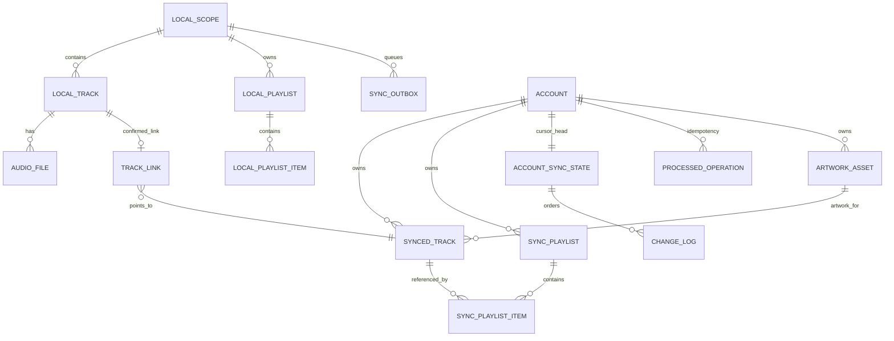

# Music Player — DATA_MODEL v1.0

**Дата:** 14 листопада 2026  
**Статус:** технічний проєкт для рев'ю; SQL-міграції ще не застосовувалися  
**Вхідні документи:** `Music_Player_PRD_v1.0.md` (13.11.2026), `ARCHITECTURE_v1.0.md` (14.11.2026)  
**Сховища:** локальна SQLite (Room KMP), серверна PostgreSQL (Supabase Auth / API / Storage)  
**Межі:** метадані й плейлисти синхронізуються; аудіофайли, локальні шляхи й права доступу — ні.

> **Статуси рішень:** SYNC-01/02 та TRACK-03/04 затверджені користувачем; інші правила — рекомендовані технічні рішення, що потребують погодження і/або PoC. Цей документ — **модель**, не свідчення про створену БД, виконані міграції чи пройдені тести.

## 1. Мета, правила моделювання та словник

- `AudioFile` — фізичний файл/документ/URI **лише на конкретному пристрої**. Може бути FLAC, MP3, AAC тощо; самі байти не потрапляють у PostgreSQL.
- `LocalTrack` — локальний логічний запис композиції. Він може містити декілька перевірених `AudioFile` різних форматів. Не обов'язково синхронізований.
- `SyncedTrack` — **композиція в єдиному каталозі акаунта** з незмінним UUID (`track_id`); може не мати жодного локального файлу на окремому пристрої.
- `TrackLink` — підтверджений зв'язок `LocalTrack` із `SyncedTrack`; це **не** копія файлу та не здогад за назвою.
- `PlaylistItem` — одне входження композиції в плейлист. Два входження того самого `SyncedTrack` мають різні `item_id`.
- `Scope` — локальна область даних: гостя або конкретного акаунта. Записи акаунта не видимі іншому акаунту на цьому пристрої.
- `OutboxOperation` — збережена локально команда для сервера; `ChangeEvent` — підтверджена серверна зміна для інших пристроїв.

### Незмінні інваріанти (обов'язкові)

1. **SYNC-01:** видалення останнього `PlaylistItem` **не змінює** `SyncedTrack.catalog_active`.
2. **SYNC-02:** `catalog_active = false` заборонено, якщо існує активне входження у **не видалений** синхронізований плейлист; `remove-from-all + disable` — одна серверна транзакція після перевірки актуального списку входжень і підтвердженої користувачем версії залежностей.
3. **SYNC-04:** додавання до синхронізованого плейлиста гарантує активне членство у спільному каталозі.
4. **TRACK-03 / TRACK-04:** ідентичність не визначається ім'ям файлу; різні назви/контейнери можуть зв'язуватися лише за доведеним збігом або явним підтвердженням.
5. Відсутність аудіофайлу або прав доступу **не видаляє** `SyncedTrack`, `PlaylistItem` чи `TrackLink` без спеціальної дії користувача.
6. Ні видалення з плейлиста, ні вимкнення синхронізації **ніколи** не видаляють фізичний аудіофайл.
7. Кожний серверний `PlaylistItem` належить **тому самому акаунту**, що і його `Playlist` та `SyncedTrack` (складені FK через `user_id`).
8. Підтверджена хмарою операція має один незмінний `operation_id`, один результат і не створює повторних ефектів від повторного надсилання.
9. Сервер не зберігає локальні абсолютні шляхи, URI, security-scoped bookmarks або сесійні токени в каталозі музики.
10. Операція локального редагування синхронізованого об'єкта і постановка до `sync_outbox` фіксуються **разом в одній транзакції SQLite**.

## 2. ER-модель (концептуально)



`SYNCED_TRACK` у цій схемі — серверна сутність; на пристрої є її локальна **репліка** `synced_tracks_cache`. `TRACK_LINK` зберігається тільки локально і посилається на UUID репліки. Cloud-only треки існують в репліці навіть без `LOCAL_TRACK`.

## 3. Типи даних і загальні правила

| Дані | SQLite / Room KMP | PostgreSQL | Правило |
| --- | --- | --- | --- |
| UUID | `TEXT` у канонічній формі | `uuid` | Генеруємо на клієнті для операцій та елементів, глобально стабільні |
| Час | `INTEGER` epoch milliseconds UTC | `timestamptz` | Серверний час не залежить від годинника клієнта |
| Тривалість аудіо | `INTEGER` мілісекунди | `integer`/`bigint` мілісекунди | Не `FLOAT` |
| Версія | `INTEGER` | `bigint` | Монотонна на кожному об'єкті; змінює сервер |
| Порядок елементів | `TEXT` | `text COLLATE "C"` | Фракційні лексикографічні ключі, алгоритм і rebalancing — у SYNC_SPEC |
| Payload події | `TEXT` (JSON) | `jsonb` | Версіонована схема payload, обмеження розміру |
| Булеві | `INTEGER` (0/1) | `boolean` | CHECK 0/1 локально |
| Хеш | `TEXT` (hex SHA-256) | `text` | Лише за потреби; хеш файлу не є акустичним відбитком |

**Індекси й FK:** увімкнути `PRAGMA foreign_keys=ON` для SQLite на кожному підключенні (не покладатися на дефолт), перевірити `WAL` і транзакції Room KMP. Серверні унікальності/FK не замінюють логічну перевірку `catalog_active`; її забезпечують **лише контрольовані серверні команди** плюс захисні перевірки/тригери.

## 4. SQLite — локальна схема

Для MVP рекомендована **одна SQLite з `scope_id` в усіх власницьких таблицях**, а не окрема БД на кожен акаунт. Усі читання й записи account-specific репозиторіїв фільтрують scope. Альтернатива з фізично окремими БД може бути прийнята пізніше за результатами security review. Токени в SQLite **не зберігаються**.

### 4.1 `local_scopes`

| Поле | Тип | Обмеження / значення |
| --- | --- | --- |
| `scope_id` | TEXT | PK, UUID |
| `kind` | TEXT | `guest` / `account` |
| `account_id` | TEXT? | UUID Supabase Auth, null для guest |
| `created_at_ms` | INTEGER | NOT NULL |
| `active` | INTEGER | 0/1, визначає показаний scope |

- `UNIQUE(kind, account_id)` для `kind='account'` через частковий індекс; єдиний початковий гостьовий scope створюється явно.
- Не підмішувати cloud-плейлисти акаунта A до акаунта B або до гостя після виходу.

### 4.2 `local_tracks`

| Поле | Тип | Обмеження / значення |
| --- | --- | --- |
| `local_track_id` | TEXT | UUID, частина PK `(scope_id, local_track_id)` |
| `scope_id` | TEXT | FK → `local_scopes` |
| `title`, `artist`, `album` | TEXT? | Зчитані display-метадані; можуть бути відсутні |
| `duration_ms` | INTEGER? | CHECK >= 0 |
| `override_title`, `override_artist`, `override_album` | TEXT? | Опціональні локальні виправлення, **не запис у файл** |
| `availability_state` | TEXT | `available`, `missing`, `permission_denied`, `unsupported`, `scanning` |
| `created_at_ms`, `updated_at_ms` | INTEGER | NOT NULL |
| `primary_artwork_id` | TEXT? | ID обкладинки, не BLOB |

- Не робити `UNIQUE(title, artist, album)` — це різні записи, ремастери або концертні версії.
- `LocalTrack` може існувати з 0 фізичних файлів, якщо файл було переміщено/видалено; доступність розраховується на основі `audio_files` та зберігається як швидкий кеш стану.
- Локальний каталог не слід фізично «об'єднувати» лише через схожість тегів.

### 4.3 `audio_files`

| Поле | Тип | Обмеження / значення |
| --- | --- | --- |
| `file_id` | TEXT | UUID, PK у scope |
| `scope_id`, `local_track_id` | TEXT | Складений FK → `local_tracks` |
| `media_locator` | TEXT | Локальний шлях / SAF URI / iOS file handle (не хмара) |
| `locator_kind` | TEXT | `path`, `content_uri`, `security_scoped`, `app_sandbox` |
| `source_id` | TEXT? | FK → `library_sources` / `access_grants` |
| `container`, `codec` | TEXT? | Визначаються за **вмістом**, не тільки розширенням |
| `bitrate_bps`, `sample_rate_hz`, `channels` | INTEGER? | CHECK позитивні, якщо задані |
| `file_size_bytes`, `last_modified_ms` | INTEGER? | Кеш ознак зміни файлу |
| `sha256` | TEXT? | Обчислювати **ліниво**, не на кожному скануванні |
| `validation_state` | TEXT | `unchecked`, `valid`, `invalid`, `needs_recheck` |
| `availability_state` | TEXT | `available`, `missing`, `permission_denied`, `offline_volume` тощо |
| `last_checked_ms` | INTEGER? | Локальний час перевірки |

- `UNIQUE(scope_id, locator_kind, media_locator)` для запобігання повторній індексації того самого locator; альтернативні URI до тих самих байтів можуть існувати як окремі записи до підтвердження.
- `sha256` відрізнятиметься для FLAC і MP3 одного запису; однаковий SHA-256 свідчить про однакові байти **за умови перевіреного хешування**, не про «схожі» пісні.
- При зміні size/mtime, втраті дозволу або підозрі на підміну — перевірити валідність прив'язки перед повторним використанням. Старий `TrackLink` не дозволяє без перевірки програвати **замінений** файл.

### 4.4 `library_sources` і `access_grants`

| Таблиця | Поля | Для чого |
| --- | --- | --- |
| `library_sources` | `source_id`, `scope_id`, `source_kind`, `display_name`, `scan_state`, `last_scan_ms` | Вибрані папки, MediaStore, імпортовані документи |
| `access_grants` | `grant_id`, `scope_id`, `source_id`, `opaque_locator`, `grant_state`, `checked_at_ms` | Платформні права; iOS bookmark/Android URI у захищеному форматі за потреби |

Не передавати в синхронізацію, експорти за замовчуванням або діагностичні логи. Платформний secret/bookmark може вимагати окремого захищеного сховища замість SQLite.

### 4.5 `synced_tracks_cache` (репліка акаунта)

| Поле | Тип | Обмеження / значення |
| --- | --- | --- |
| `scope_id`, `track_id` | TEXT | Складений PK; тільки scope=`account` |
| `title`, `artist`, `album`, `duration_ms` | TEXT/INTEGER? | Зі спільного каталогу |
| `catalog_active` | INTEGER | 0/1 — окремо від входжень до плейлистів |
| `artwork_id` | TEXT? | Приватний cloud-artwork ID |
| `server_version` | INTEGER | Версія останнього підтвердженого стану |
| `removed_at_ms` | INTEGER? | Tombstone, якщо синхронізацію вимкнено |
| `sync_projection_state` | TEXT | `confirmed`, `pending`, `conflict` (UI-проєкція) |

**Cloud-only композиція** має запис у `synced_tracks_cache` без жодного підтвердженого `track_link`. У UI вона є в плейлисті, але не відтворюється, поки користувач не зв'яже її з доступним локальним файлом.

### 4.6 `track_links` і `match_candidates`

| Таблиця | Основні поля | Обмеження |
| --- | --- | --- |
| `track_links` | `scope_id`, `local_track_id`, `track_id`, `verification_method`, `verified_at_ms`, `binding_revision` | `UNIQUE(scope_id, local_track_id)` — не більше одного активного cloud ID для локальної композиції; багато LocalTrack можуть посилатися на один SyncedTrack |
| `match_candidates` | `candidate_id`, `scope_id`, `track_id`, `local_track_id`, `evidence_json`, `confidence_class`, `status`, `created_at_ms` | Кандидат **ніколи** не запускається як підтверджений зв'язок |

`verification_method`: `previously_confirmed`, `identical_sha256`, `user_confirmed`, `verified_import`. Теги, ім'я файлу, тривалість і MusicBrainz ID використовуються для **кандидатів**, а не автоматичного безумовного зв'язку. `match_candidates` можна видаляти як кеш; `track_links` потрібно зберігати надійно й дозволяти unlink.

### 4.7 `local_playlists` і `local_playlist_items`

| Таблиця | Основні поля | Обмеження |
| --- | --- | --- |
| `local_playlists` | `scope_id`, `playlist_id`, `cloud_playlist_id?`, `kind`, `name`, `order_version`, `server_version?`, `deleted_at_ms?`, `sync_state` | `kind`: `local` / `synced`; одна cloud playlist має лише одну локальну репліку в scope |
| `local_playlist_items` | `scope_id`, `item_id`, `playlist_id`, `local_track_id?`, `synced_track_id?`, `order_key`, `deleted_at_ms?`, `server_version?` | Окремий PK `item_id`, FK playlist; **не UNIQUE(playlist_id, track_id)** |

- Для **синхронізованого** плейлиста кожне активне входження повинне мати `synced_track_id`; локальний `local_track_id` — необов'язкова підказка, а не серверна ідентичність.
- Для локального плейлиста допустимий `local_track_id`; за потреби допускається cloud-only `synced_track_id` в account scope.
- `CHECK (local_track_id IS NOT NULL OR synced_track_id IS NOT NULL)`; зв'язки належать тому самому scope. Правило «synced playlist ⇒ synced_track_id» у SQLite забезпечити додатковим тригером/use case, оскільки простий CHECK не бачить іншої таблиці.
- `deleted_at_ms` — м'яке видалення плейлиста (кошик). Входження зберігаються, щоб відновити порядок, але **не є активними посиланнями**, поки плейлист у кошику.
- Відновлення плейлиста після ручного вимкнення синхронізації його треків: **не відновлювати автоматично**; показати залежності й попросити окреме підтвердження одночасного повторного ввімкнення каталогу або залишити плейлист у кошику.

### 4.8 `artwork_cache`

`scope_id`, `artwork_id`, `source_kind` (`embedded`, `folder`, `cloud`), `source_identity?`, `content_hash?`, `cache_path`, `width`, `height`, `encoded_bytes`, `cache_version`, `last_access_ms`, `state`.

- База не містить оригінальної обкладинки як BLOB. Для однієї однакової обкладинки — один файл у кеші в межах дозволеного scope; декодовані бітмапи кешуються в RAM з лімітом.
- Якщо файл кешу зник, БД-рядок не є фатальною помилкою: відновити кеш або показати placeholder.

### 4.9 `sync_outbox`, `sync_cursor`, `sync_conflicts`

| Таблиця | Поля | Правило |
| --- | --- | --- |
| `sync_outbox` | `scope_id`, `operation_id`, `op_type`, `entity_type`, `entity_id`, `payload_json`, `payload_schema`, `base_version`, `status`, `attempts`, `retry_after_ms`, `created_at_ms`, `last_error_code` | PK `(scope_id, operation_id)`; `payload` та ID **не змінювати після enqueue** |
| `sync_cursor` | `scope_id`, `account_id`, `last_applied_seq`, `last_snapshot_seq?`, `last_synced_ms?`, `state` | `last_applied_seq` оновити **у тій самій SQLite-транзакції**, що й отримані зміни |
| `sync_conflicts` | `conflict_id`, `scope_id`, `operation_id`, `entity_id`, `reason_code`, `server_state_json`, `status` | Операцію не втрачати; дозволити перегляд і повторне рішення |

- Для локального редагування: `BEGIN` → зміни плейлиста/каталогу → `sync_outbox INSERT` → `COMMIT`; ніколи не відправляти запит у мережу **всередині** SQLite-транзакції.
- Для pull: **одна транзакція** застосовує події та курсор. Pending локальні операції не перезаписувати отриманими подіями: або окрема server-replica/optimistic-проєкція, або визначений rebase. Детальний алгоритм — `SYNC_SPEC.md`.
- Обережно з неуспішним SYNC-02 офлайн: показувати `pending confirmation`, не фінальний `disabled`, до ACK сервера.

### 4.10 `playback_state` і `playback_queue_items`

`playback_state`: `scope_id`, `queue_id`, `current_queue_item_id?`, `position_ms`, `shuffle_enabled`, `repeat_mode`, `updated_at_ms`.

`playback_queue_items`: `scope_id`, `queue_item_id`, `queue_id`, `local_track_id?`, `synced_track_id?`, `order_index`, `added_at_ms`; дублікати допускаються. Відновлюється **лише на цьому пристрої**, не синхронізується. Якщо файл зник, playback resolver не підставляє інший за назвою.

### 4.11 Опціональні локальні таблиці

`library_scan_jobs` — прогрес інкрементального сканування; `favorite_tracks` — локальне «Улюблене» для MVP (чи синхронізувати обране — окреме продуктове рішення); `import_mappings` — зіставлення під час M3U8/експорту. Не вводити їх без необхідного use case.

## 5. PostgreSQL/Supabase — серверна схема

Сервер зберігає **лише синхронізований стан** одного акаунта; гостя тут немає. `user_id` завжди походить із `auth.uid()`/перевіреної серверної сесії — **не довіряємо** власнику, переданому в клієнтському payload.

### 5.1 Таблиці каталогу й плейлистів

| Таблиця | Ключі та основні поля | Індекси / інваріанти |
| --- | --- | --- |
| `profiles` | `user_id uuid PK FK auth.users(id)`, `created_at`, `preferences_json` | Мінімум особистих даних |
| `synced_tracks` | `(user_id, track_id) PK`, `title`, `artist`, `album`, `duration_ms`, `artwork_id?`, `catalog_active boolean`, `version bigint`, `removed_at?`, `created_at`, `updated_at` | Індекси `(user_id, catalog_active)`, `(user_id, updated_at)`; `catalog_active` **не** похідний від playlist items |
| `playlists` | `(user_id, playlist_id) PK`, `name`, `version`, `deleted_at?`, `created_at`, `updated_at` | Індекс активних `(user_id, updated_at) WHERE deleted_at IS NULL` |
| `playlist_items` | `(user_id, item_id) PK`, `playlist_id`, `track_id`, `order_key text COLLATE "C"`, `version`, `deleted_at?`, `created_at` | FK `(user_id, playlist_id)` і `(user_id, track_id)`; `UNIQUE(user_id, playlist_id, order_key) WHERE deleted_at IS NULL` |
| `artwork_assets` | `(user_id, artwork_id) PK`, `content_hash`, `storage_key`, `mime_type`, `width`, `height`, `bytes`, `created_at`, `removed_at?` | Унікальний активний `(user_id, content_hash)`; **ніякого** постійного публічного URL |
| `synced_track_evidence` (опц.) | `user_id`, `evidence_id`, `track_id`, `kind`, `value`, `verified_at` | Exact SHA-256/MusicBrainz evidence з privacy review; без автоматичного злиття за metadata-only evidence |

**Повторна композиція в плейлисті:** `playlist_items.item_id` унікальний, але `playlist_items.track_id` **не** унікальний для плейлиста.

**Життєвий цикл:**

- `catalog_active=true`: логічний трек присутній у спільному каталозі. Індикатор «синхронізовано» не означає наявність аудіо на іншому пристрої.
- `catalog_active=false` з `removed_at`: tombstone, потрібний для видалення на віддалених репліках; фізичний hard-delete — лише після узгодженої політики retention / backup / privacy.
- `playlists.deleted_at`: кошик (орієнтир 30 днів, **не остаточно погоджений**). Входження лишаються для відновлення; під час перевірки активних залежностей вони не враховуються, доки плейлист видалено.
- `playlist_items.deleted_at`: окреме видалення входження; подія з tombstone зберігається в `change_log`.
- `artwork_assets.removed_at`: планове прибирання сиріт лише після перевірки чинних посилань, retention та Storage permissions.

### 5.2 Таблиці синхронізації та пристроїв

| Таблиця | Основні поля | Для чого |
| --- | --- | --- |
| `account_sync_state` | `user_id PK`, `head_seq bigint`, `min_retained_seq bigint`, `snapshot_revision bigint` | **Пер-акаунтний транзакційний курсор**; блокування рядка серіалізує мутації акаунта |
| `change_log` | `(user_id, seq) PK`, `operation_id`, `entity_type`, `entity_id`, `action`, `payload jsonb`, `payload_schema`, `created_at` | Упорядкований журнал лише підтверджених транзакцій |
| `processed_operations` | `(user_id, operation_id) PK`, `request_hash`, `result_json jsonb`, `result_seq`, `processed_at` | Idempotency; однаковий ID з іншими байтами запиту → `OP_ID_REUSE` |
| `devices` | `(user_id, device_id) PK`, `display_name`, `platform`, `last_seen_at`, `last_applied_seq?` | Ідентифікатор інсталяції ≠ Supabase Auth session; видалення device row **не** відкликає сесію автоматично |

**Ключовий нюанс курсора.** Не можна використовувати звичайний `BIGSERIAL` як доказ commit-order: два паралельні клієнти можуть отримати номери в одному порядку, а закомітитися в іншому. Рекомендовано: спочатку взяти row-lock `account_sync_state` поточного користувача, у тій самій транзакції застосувати команду, оновити `head_seq` і записати відповідні `change_log` події. Конкурентна транзакція цього самого акаунта чекатиме на commit/rollback. Це потрібно протестувати з двома одночасними пристроями.

### 5.3 Мінімальні серверні API / RPC

| Операція | Результат | Примітка |
| --- | --- | --- |
| `apply_sync_operation(operation_id, op_type, payload, base_version)` | `ack`, `result_seq`, актуальні версії або conflict | Ідемпотентно; `user_id` із Auth, не payload |
| `pull_changes(after_seq, limit)` | упорядковані події, `next_seq`, `head_seq`, `requires_snapshot` | Якщо курсор старіший за retention, потрібен snapshot |
| `get_sync_snapshot()` | узгоджені записи й `head_seq` | У рамках однієї консистентної snapshot-операції, з пагінацією при великих бібліотеках |
| `preview_disable_track(track_id)` | актуальні залежності, версія/хеш списку | Діалог SYNC-02; повертає назви плейлистів |
| `disable_track_sync(track_id, expected_track_version, expected_dependencies_digest, remove_from_all)` | success/conflict | **Одна транзакція**; при нових залежностях потребує нове підтвердження |
| `restore_playlist(playlist_id, expected_version, restore_disabled_tracks_confirmed)` | restored / requires_confirmation / conflict | Не відновлювати приховано раніше вимкнуті треки |

`apply_sync_operation` має підтримувати **типізовані й дозволені** команди; не приймати довільне SQL/JSON-переписування таблиць. Ідентифікатор команди та payload незмінні від першої спроби до ACK.

### 5.4 Відновлення кошика після SYNC-02

Умовний приклад:

1. Плейлист P (із композицією T) видалили в кошик. `P.deleted_at != null`; посилання на T у цьому плейлисті **не активне**.
2. Користувач вручну вимкнув синхронізацію T. Сервер не знаходить **активних** входжень і дозволяє SYNC-02, зберігаючи tombstone T.
3. Користувач хоче відновити P. Якби сервер просто прибрав `deleted_at`, з'явилося б активне входження на `catalog_active=false` — порушення інваріанту.
4. `restore_playlist` повертає `requires_confirmation` і перелік T (та інших вимкнених треків).
5. Після підтвердження сервер **атомарно** повторно активує необхідні записи каталогу й відновлює P; без підтвердження P залишається в кошику.

Якщо tombstone/дані треку вже видалені за retention, відновлення має окремий сценарій «неповні дані / обрати пропуск або скасувати», **без автоматичної підстановки іншої пісні**.

### 5.5 Серверна безпека та RLS

- У всіх exposed таблицях **увімкнути RLS**, дозволити читання тільки власнику, привілеї запису в таблиці каталогу/плейлистів **не видавати** клієнтським ролям; усі зміни через вузькі серверні команди.
- `auth.uid()` — єдине джерело поточного користувача. Композитні FK гарантують відсутність випадкових міжакаунтних зв'язків і захищають від помилок навіть у privileged functions.
- Розмістити privileged `SECURITY DEFINER` функції у **не-exposed schema** (наприклад `app_private`), `SET search_path=''`, повністю кваліфікувати назви, перевіряти власника всіх зачеплених рядків; надати лише вузький `EXECUTE`. Зовнішній `public` RPC може бути `SECURITY INVOKER` wrapper, який викликає перевірену приватну функцію.
- `processed_operations`, `change_log`, `account_sync_state` не доступні для довільного запису/читання клієнтів; pull працює через перевірений RPC.
- Приватний Supabase Storage bucket: правила шляху для власника, перевірка MIME/розміру/декодування, без постійного публічного URL.
- `service_role`/secret key **ніколи** не включати в мобільні або Windows-бінарники.
- `devices` — інвентар інсталяцій; керування активними Auth-сесіями потребує окремої інтеграції з Supabase Auth та перевірки її фактичних можливостей.

## 6. Зразки SQL (ілюстративні, не готові міграції)

### 6.1 PostgreSQL: FK ізоляції акаунтів та повтори в плейлистах

```sql
create table public.synced_tracks (
    user_id uuid not null references auth.users(id),
    track_id uuid not null,
    title text not null,
    artist text,
    album text,
    duration_ms bigint check (duration_ms is null or duration_ms >= 0),
    catalog_active boolean not null default true,
    version bigint not null default 1 check (version >= 1),
    removed_at timestamptz,
    primary key (user_id, track_id)
);

create table public.playlists (
    user_id uuid not null references auth.users(id),
    playlist_id uuid not null,
    name text not null check (char_length(name) between 1 and 200),
    version bigint not null default 1 check (version >= 1),
    deleted_at timestamptz,
    primary key (user_id, playlist_id)
);

create table public.playlist_items (
    user_id uuid not null,
    item_id uuid not null,
    playlist_id uuid not null,
    track_id uuid not null,
    order_key text collate "C" not null,
    version bigint not null default 1 check (version >= 1),
    deleted_at timestamptz,
    primary key (user_id, item_id),
    foreign key (user_id, playlist_id)
        references public.playlists(user_id, playlist_id),
    foreign key (user_id, track_id)
        references public.synced_tracks(user_id, track_id)
);

create unique index playlist_items_active_order
on public.playlist_items (user_id, playlist_id, order_key)
where deleted_at is null;

create index playlist_items_by_track
on public.playlist_items (user_id, track_id)
where deleted_at is null;
```

**Зверни увагу:** FK не перевіряє `catalog_active` і не знає, чи плейлист у кошику. Правила активності реалізує серверна транзакція; бажаний додатковий `constraint trigger` / policy hardening після тестування race conditions. Не видавати клієнту прямі `INSERT/UPDATE/DELETE` grants на ці таблиці.

### 6.2 SQLite: логічна композиція ≠ фізичний файл

```sql
pragma foreign_keys = on;

create table local_scopes (
    scope_id text primary key,
    kind text not null check (kind in ('guest', 'account')),
    account_id text,
    created_at_ms integer not null,
    active integer not null default 0 check (active in (0,1)),
    check ((kind = 'guest' and account_id is null)
        or (kind = 'account' and account_id is not null))
);

create unique index local_scopes_one_account
    on local_scopes(account_id) where kind = 'account';

create table local_tracks (
    scope_id text not null,
    local_track_id text not null,
    title text,
    artist text,
    album text,
    duration_ms integer check (duration_ms is null or duration_ms >= 0),
    availability_state text not null default 'scanning',
    primary key (scope_id, local_track_id),
    foreign key (scope_id) references local_scopes(scope_id)
);

create table audio_files (
    scope_id text not null,
    file_id text not null,
    local_track_id text not null,
    media_locator text not null,
    locator_kind text not null,
    container text,
    codec text,
    sha256 text,
    validation_state text not null default 'unchecked',
    primary key (scope_id, file_id),
    foreign key (scope_id, local_track_id)
       references local_tracks(scope_id, local_track_id)
);

create unique index audio_file_locator_unique
on audio_files (scope_id, locator_kind, media_locator);
```

Ці уривки демонструють **форму обмежень**, не повноту міграцій. Перед застосуванням треба додати всі колонки, політики, таблиці, індекси, транзакційні RPC і тести; не запускати уривки у виробничому Supabase без окремого review.

## 7. Індекси та цільові запити

| Запит | Рекомендований індекс / підхід |
| --- | --- |
| Пошук композицій за назвою/виконавцем | SQLite FTS5 або нормалізований search index; перевірити KMP-підтримку в PoC |
| Усі локальні файли композиції | `audio_files(scope_id, local_track_id)` |
| Знайти доступний файл із пріоритетним форматом | `audio_files(scope_id, local_track_id, availability_state)` + вибір у домені |
| Вміст плейлиста за порядком | SQLite `(scope_id, playlist_id, order_key)`; Postgres `(user_id, playlist_id, order_key) WHERE deleted_at IS NULL` |
| Всі активні входження треку перед SYNC-02 | Postgres `(user_id, track_id) WHERE deleted_at IS NULL` + join `playlists.deleted_at IS NULL` |
| Всі активні треки каталогу | Postgres `(user_id, catalog_active)` |
| Невідправлений outbox | SQLite `(scope_id, status, retry_after_ms, created_at_ms)` |
| Pull подій після курсора | Postgres PK `(user_id, seq)` |
| Ідемпотентне повторення | Postgres PK `(user_id, operation_id)` |
| Дедуплікація обкладинок | Унікальний `(user_id, content_hash)` за активним станом |

Пошук 10 000+ файлів, WAL, стани дисків, повні / часткові індекси та FTS треба вимірювати в release-build на всіх трьох платформах. Не виконувати сортування тисяч елементів на головному UI-потоці.

## 8. Сценарії приймання моделі даних

| ID | Сценарій | Очікуваний результат |
| --- | --- | --- |
| DM-01 | Два `music.mp3` з різними аудіозаписами | Два локальні записи, жодного автоматичного неправильного link |
| DM-02 | Однакові байти, різні назви | Можливий перевірений link до одного cloud Track ID |
| DM-03 | MP3 і FLAC одного запису | Різні `audio_files`, один SyncedTrack після підтвердження |
| DM-04 | Композиція двічі у плейлисті | Два `item_id`, обидва відтворюються у відповідних позиціях |
| DM-05 | Видалити останній елемент із синхронізованого плейлиста | `catalog_active` лишається true |
| DM-06 | SYNC-02 за наявності активних входжень | Звичайне disable відхиляється, atomically remove-all+disable після підтвердження |
| DM-07 | Інший пристрій додав трек під час діалогу SYNC-02 | Конфлікт, новий перелік плейлистів і повторне підтвердження |
| DM-08 | Вимкнули зовнішній диск | `audio_files` unavailable, `synced_tracks_cache` і playlist items лишилися |
| DM-09 | Загубився ACK після commit | Повтор того самого `operation_id` не дублює вставку |
| DM-10 | Два паралельні записи change log одного акаунта | Курсор не пропускає пізніше закомічену подію |
| DM-11 | Локальний edit офлайн + серверний update того самого об'єкта | Pending outbox збережено; конфлікт обробляється явно |
| DM-12 | Видалили плейлист, вимкнули sync треку, відновлюють плейлист | Потрібне підтвердження повторної активації або відновлення скасовано |
| DM-13 | Вийшли з A, увійшли в B на тому самому пристрої | Дані A не показуються як дані B, без автоматичного злиття |
| DM-14 | Користувач B підставив `track_id` користувача A в API | Сервер відхиляє через власника / composite FK / RPC check |
| DM-15 | Оригінал обкладинки зник із кешу | Placeholder / повторне отримання, без впливу на плейлист чи звук |
| DM-16 | Видалили акаунт | Серверні персональні дані стираються за політикою, аудіофайли локально не чіпаються |
| DM-17 | Старий курсор після очищення journal | Узгоджений snapshot + збереження/перебазування локального outbox |

## 9. Міграції, retention і відновлення

1. Кожна зміна SQLite через **версіоновану Room KMP migration**, тест зі старою БД, FK integrity check та сценаріями crash-recovery. Заборонити destructive migration як типовий спосіб оновлення користувацьких плейлистів.
2. PostgreSQL-схема — тільки через версіоновані `supabase/migrations/*.sql`, із перевіркою RLS/GRANT/SECURITY DEFINER та rollback strategy.
3. `processed_operations` зберігати довше за підтримуване вікно повторів; якщо чистити — протокол має явно пояснювати, як старі клієнти не створюють дублікати.
4. `change_log` видаляти тільки разом із `min_retained_seq` та безпечним snapshot fallback. `devices.last_applied_seq` — telemetry, **не** сам по собі доказ можливості очищення.
5. Кошик: пропозиція **30 днів**, але остаточні терміни очищення, експорту/приватності та бекапів потрібно погодити.
6. База синхронізації не є бекапом: потрібне серверне резервне копіювання та переносний експорт плейлистів/метаданих (без аудіо за замовчуванням).
7. Всі фонові задачі сканування/хешування/мініатюр повинні бути обмежені, переривані й не блокувати аудіодвижок або запуск UI.

## 10. Рішення, відкриті до фінального затвердження

| ID | Питання | Рекомендація | Наслідок |
| --- | --- | --- | --- |
| DM-DEC-01 | Одна SQLite зі scope або окремі БД | Одна з `scope_id`, із тестами ізоляції | Простота Room/міграцій vs посилення фізичної ізоляції |
| DM-DEC-02 | Алгоритм `order_key` і reorder | Fractional keys + optimistic playlist version, bounded rebalancing | Потрібні тести сортування й колізій на SQLite/Postgres |
| DM-DEC-03 | Кошик 30 днів | Рекомендовано, не погоджено остаточно | Retention, privacy, Storage quota |
| DM-DEC-04 | Дані при guest → account | Явний вибір плейлистів, копіювання + ідемпотентне створення у cloud | Без автоматичного змішування акаунтів |
| DM-DEC-05 | Sync evidence з file SHA-256 | Лише за потреби й з privacy review | Хеш може опосередковано ідентифікувати файл |
| DM-DEC-06 | Чи синхронізувати «Улюблене» | Поки локально; окреме погодження | Простота MVP |
| DM-DEC-07 | Відновлення треків кошика після SYNC-02 | Запит явного дозволу на re-enable | Не порушує SYNC-02 |
| DM-DEC-08 | Масштаб sync journal / розмір операцій | Пагінація, ліміти batch, snapshot fallback | Потрібне навантажувальне тестування |

## 11. План наступного кроку: SYNC_SPEC.md

1. Типізовані команди, event schema, payload versioning, error codes (`CONFLICT`, `DEPENDENCIES_CHANGED`, `OP_ID_REUSE`, `CURSOR_EXPIRED`).
2. SQL-транзакції для `add_item`, `remove_item`, `move_item`, `disable_track_sync`, `restore_playlist` з локами в одному порядку.
3. Client reconciliation: optimistic state / confirmed state / pending, retry with backoff, offline queue.
4. Пагінований snapshot з консистентним `head_seq` та алгоритм rebase outbox.
5. Конкурентні integration tests для SYNC-01/02 й cursor ordering, RLS/privilege tests для user A/B, anon.
6. Після підписання DATA_MODEL і SYNC_SPEC — створення **справжніх** SQLite/Room Entity та PostgreSQL migration файлів у репозиторії, а не раніше.

## 12. Технічні джерела (перевірено 14.11.2026)

- [Room KMP: база, драйвери та транзакції](https://developer.android.com/kotlin/multiplatform/room)
- [SQLite KMP: BundledSQLiteDriver](https://developer.android.com/kotlin/multiplatform/sqlite)
- [SQLite: PRAGMA foreign_keys](https://www.sqlite.org/pragma.html#pragma_foreign_keys)
- [Supabase: Row Level Security і policy tests](https://supabase.com/docs/guides/database/postgres/row-level-security)
- [Supabase: SQL functions / SECURITY DEFINER / grants](https://supabase.com/docs/guides/database/functions)
- [PostgreSQL: transaction isolation, row locking, retry](https://www.postgresql.org/docs/current/transaction-iso.html)

---

**Висновок:** модель захищає від плутанини між локальними файлами та синхронізованими композиціями, зберігає SYNC-01/02 і TRACK-03/04 та підтримує надійну офлайн-синхронізацію. Вона достатньо детальна, щоб спроєктувати `SYNC_SPEC.md`, але ще **не є готовою production SQL-схемою**.
