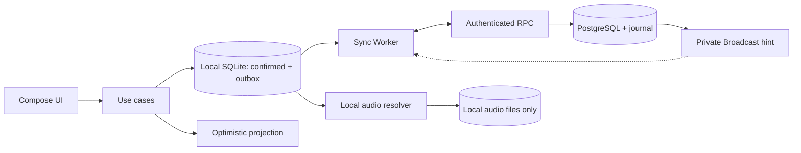

# Music Player — SYNC_SPEC v1.0

> **Узгодження 18.11.2026:** поточна назва — Ritorn; історичні заголовки та назви файлів збережено. Статуси й джерела рішень — у [DECISIONS.md](DECISIONS.md). P0/P1 означають пріоритет, не затвердження технології. Стек і контракти залишаються пропозиціями до рев’ю/PoC.

**Дата:** 14 листопада 2026  
**Статус:** проєкт технічної специфікації для рев'ю; не реалізовано й не протестовано на Supabase  
**Вхідні документи:** `Music_Player_PRD_v1.0.md`, `ARCHITECTURE_v1.0.md`, `DATA_MODEL_v1.0.md`  
**Область:** синхронізація **метаданих, логічних треків, плейлистів і компактних обкладинок** між пристроями одного акаунта. **Не** передає аудіобайти, файлові шляхи, дозволи, playback queue чи позицію відтворення.

> **Статус затвердження:** SYNC-01, SYNC-02, TRACK-03 і TRACK-04 — узгоджені продуктові правила. Деталі цього протоколу, включно з форматом команд, політикою конфліктів, тайм-аутами, retention та алгоритмом reorder, — **технічні пропозиції**, які потребують рев'ю, PoC і навантажувальних тестів. Приклади JSON/SQL нижче — контракти й псевдокод, **не готові міграції**.

---

## 1. Мета, терміни й гарантії

### 1.1 Основні терміни

- **Локальний запис** — підтверджена на пристрої інформація про файл (`AudioFile`), локальну композицію (`LocalTrack`) або локальний плейлист; може існувати без акаунта.
- **Синхронізований трек** (`SyncedTrack`) — логічний запис у каталозі акаунта зі стабільним UUID, **не** аудіофайл.
- **Синхронізований плейлист** — набір `PlaylistItem`, кожен з власним UUID, що посилається на `SyncedTrack`.
- **Confirmed replica** — останній узгоджений із сервером стан синхронізованих об'єктів у SQLite.
- **Pending intent / outbox** — локально збережена незавершена команда користувача; окрема від confirmed replica.
- **Optimistic view** — представлення для UI: confirmed replica плюс незавершені локальні команди, застосовані детерміновано.
- **Server journal** (`change_log`) — упорядковані підтверджені серверні події для акаунта.
- **Cursor** — останній `seq`, який пристрій **успішно застосував** локально, а не просто одержав по мережі.
- **Operation ID** — стабільний UUID команди для ідемпотентних повторів; **не** змінювати між повторними спробами.

### 1.2 Вимоги до властивостей системи

| Властивість | Гарантія / обмеження |
|---|---|
| Offline-first | Місцеві дії відображаються одразу; синхронізація відновиться після мережі |
| No data loss | Невідправлена дія лишається в outbox до ACK, явного скасування або обробленого конфлікту |
| At-least-once delivery | Клієнт може повторно надсилати команду; мережа не гарантує рівно одну доставку |
| Effectively-once effect | Сервер гарантує один ефект на `(user_id, operation_id)` у межах прийнятої політики retention |
| Ordered durable pull | Для кожного акаунта є монотонний транзакційний `seq`; пристрій не пропускає committed-події |
| Account isolation | Жодна команда, pull або Broadcast не відкриває даних іншого акаунта |
| Non-destructive media | Синхронізація не перейменовує, не перекодовує й не видаляє фізичні файли |
| Eventual convergence | За доступної мережі, відсутності нерозв'язаних конфліктів та підтримуваних версій клієнти збігаються до серверного стану |
| No silent corruption | При суперечності/невизначеному матчі не підставляємо інший аудіозапис або не перезаписуємо дію непомітно |

**Не обіцяємо:** миттєвий стан на всіх пристроях, доставку Realtime «рівно один раз», відсутність конфліктів чи автоматичне відновлення після видалення з резервної копії.

### 1.3 Локальна історія поза sync-протоколом

STAT-01 погоджує ранній локальний збір історії, а не її синхронізацію. `playback_sessions` та можливі `playback_events`, listening duration і похідні метрики залишаються лише на пристрої. Не включати їх до серверного journal, `synced_tracks`, payload команд, snapshot чи `sync_outbox` без окремого погодженого продуктового рішення й рев’ю протоколу/приватності. Collector працює без Supabase та Auth. Технічні метрики sync у §17 не є історією прослуховувань.

## 2. Бізнес-інваріанти та запропоновані уточнення

Затверджені SYNC-01/02, TRACK-03/04 та інші явно підтверджені продуктові рішення перелічені в [DECISIONS.md](DECISIONS.md). Пов’язані вимоги PRD збережено; конкретна обробка кошика, версій і команд нижче не отримує статус Approved лише від включення в цей розділ.

1. **SYNC-01:** видалення композиції з останнього синхронізованого плейлиста не змінює `synced_tracks.catalog_active`. Лише явна команда вимкнення синхронізації змінює членство в каталозі.
2. **SYNC-02:** звичайне `disable_track_sync` можливе тільки без активних входжень композиції в невидалені синхронізовані плейлисти. Якщо такі входження є, користувач бачить перелік і може обрати **переглянути**, **видалити з усіх і вимкнути**, **скасувати**. Уся зміна застосовується атомарно лише після серверної перевірки актуальних залежностей.
3. **SYNC-04:** додавання локальної композиції до синхронізованого плейлиста гарантує активне членство відповідного логічного треку в єдиному каталозі акаунта. Користувач також може додавати треки до каталогу вручну.
4. **TRACK-03:** однаковий filename або теги не є доказом однакового аудіозапису; не можна автоматично прив'язувати неправильну пісню.
5. **TRACK-04:** різні назви/формати аудіофайлів можуть посилатися на один `SyncedTrack` лише після встановленої відповідності або підтвердження користувача.
6. **PL-01:** повтор одного треку в одному плейлисті дозволений: `item_id` у кожного входження власний.
7. Фізичний аудіофайл, його URI і локальна доступність не синхронізуються й не видаляються через зміни каталогу.
8. Стан кошика плейлистів не вважається активною залежністю для SYNC-02, але відновлення кошика перевіряє, чи всі потрібні треки досі активні.
9. Синхронізована іконка відображає **членство метаданих у каталозі**, а не наявність музичного файлу на інших пристроях.

## 3. Архітектурні учасники та межі довіри



- Додаток не містить серверного `service_role`/secret key.
- Клієнт не записує напряму таблиці каталогу, плейлистів або журналу: дозволені тільки типізовані RPC з перевірками.
- `auth.uid()` / перевірена сесія визначає `user_id`; значення, прислане клієнтом, не є авторитетним.
- Realtime Broadcast — **тільки сигнал** «можуть бути нові зміни». Стан отримується через `pull_changes`/snapshot.
- Доступ до конкретного локального файлу вирішується лише на цьому пристрої (`TrackLink`, `AudioFile`, platform permissions).

## 4. Дані протоколу та мінімальні зміни до DATA_MODEL

### 4.1 Локальна SQLite

Необхідні сутності з `DATA_MODEL_v1.0`:

- `local_scopes`, `local_tracks`, `audio_files`, `track_links`;
- `local_playlists`, `local_playlist_items`, `synced_tracks_cache`;
- `sync_outbox`, `sync_cursor`, `sync_conflicts`.

**Рекомендовані уточнення схеми перед міграціями:**

| Зміна | Причина |
|---|---|
| `sync_outbox.depends_on_operation_id?`, `client_created_seq`, `last_response_json?`, `conflict_context_json?` | Порядок команд, відстеження ACK та конфліктів |
| `sync_outbox.status`: `pending`, `sending`, `acked_waiting_pull`, `confirmed`, `needs_review`, `blocked_auth`, `canceled` | ACK і локальне застосування журналу — **окремі етапи**; `sending` не є durable-ACK |
| `synced_tracks_cache`/playlists/items як **confirmed** проєкції, а local pending intents окремо | Pull не має стирати локальні оптимістичні зміни |
| `sync_cursor.snapshot_session_id?`, `snapshot_stage_state?` | Безпечне resume/restart повного знімка |
| `sync_snapshot_staging` (тимчасова таблиця/кілька таблиць) | Не показувати частково завантажений snapshot |
| `local_playlists`: `metadata_version`, `content_version`, `order_version` (або еквівалент) | Незалежні види конфліктів, менше хибних блокувань |
| `local_playlist_items`: confirmed row + pending projections | Стабільні `item_id` і видимість unsynced edits |

**Важливо:** якщо Room-модель уже матиме єдині матеріалізовані оптимістичні таблиці замість двох проєкцій, потрібен формально доведений deterministic rebase; для першої реалізації надійніше вести confirmed state окремо від pending intents.

### 4.2 Серверна PostgreSQL

Обов'язкові `synced_tracks`, `playlists`, `playlist_items`, `account_sync_state`, `change_log`, `processed_operations`, `devices` з `DATA_MODEL_v1.0`.

Додаткові поля / таблиці-кандидати:

- `playlists.metadata_version`, `content_version`, `order_version` (замість або поряд із загальною `version`);
- `change_log.payload_schema` і `entity_version`, `operation_id`, `event_type`, `group_id`, `group_index`, `group_count`; одна підтверджена операція може породжувати **кілька** послідовних `seq`, але клієнт мусить застосувати їх як **одну атомарну групу**;
- `sync_snapshot_sessions` (`user_id`, `snapshot_id`, `head_seq`, `expires_at`, `status`, `checksum`) та `sync_snapshot_chunks`/stable snapshot rows — для надійної пагінації;
- `account_sync_state.min_retained_seq`, `head_seq` з транзакційним блокуванням;
- збереження `processed_operations` у MVP **без автоматичної короткої очистки**; політику видалення визначити до зростання обсягу.

Усі зовнішні ключі плейлиста/треку на сервері — складені `(user_id, entity_id)`. Усі exposed таблиці — з RLS і контрольованими grants. Серверний інваріант `catalog_active` не забезпечується лише FK, потрібна контрольована команда та захисні перевірки.

## 5. Версії, ідентифікатори та API-контракти

### 5.1 Загальні правила

- Ідентифікатори `operation_id`, `playlist_id`, `item_id`, `track_id` — UUID. `device_id` — ідентифікатор конкретної інсталяції (не тотожний Auth session).
- `protocol_version` і `payload_schema` — цілі числа, перша підтримувана версія `1`.
- `base_version` — серверна версія цільового об'єкта, відома при створенні команди. Її **не переписувати** в тому самому outbox entry після відправлення.
- Детермінований `request_hash` обчислюється із канонічного `op_type` + незмінних параметрів і payload; повтор того самого UUID з іншим hash — помилка `OP_ID_REUSE`.
- Час клієнта (`created_at_ms`) — інформаційний. Ні порядок комітів, ні вирішення конфліктів не спираються на локальний годинник.
- `user_id` визначає сервер із сесії, а не із payload.
- Команда або змінює стан разом із journal/idempotency record, або не змінює нічого (в одній DB-транзакції).

### 5.2 Базовий push-запит (ілюстративний JSON)

```json
{
  "protocol_version": 1,
  "operation_id": "5a56c052-c116-4420-9b64-bd36b179eae0",
  "device_id": "909b2c37-c0c2-4ad7-a705-41cb62166d55",
  "op_type": "playlist_item.add",
  "base_version": null,
  "payload": {
    "playlist_id": "f2738c1c-2d2e-4f53-9ddb-3891e539760a",
    "item_id": "0678b4b0-196e-4ba8-b246-e3581480b843",
    "track_id": "9eb31a10-2bfb-4c5e-8bd7-f341357fdd83",
    "before_item_id": null,
    "after_item_id": null
  }
}
```

Це приклад для треку, який уже існує в каталозі. Для **нового локального треку**, який користувач саме додає до синхронізованого плейлиста, **рекомендовано одну атомарну команду** `playlist_item.add_with_new_track` (вкладені перевірені метадані нового треку, новий `track_id` та `item_id`) — створення каталожного запису й входження здійснюються в **одній серверній транзакції**. Це усуває можливий проміжний стан «трек уже в каталозі, але додавання до плейлиста не вдалося». Для ручного додавання до каталогу без плейлиста існує окрема `track.create`. Якщо трек уже синхронізований, використовується звичайний `playlist_item.add`; якщо він був вимкнений, потрібна явна реактивація.

### 5.3 Успішний ACK

```json
{
  "status": "applied",
  "operation_id": "5a56c052-c116-4420-9b64-bd36b179eae0",
  "result_seq": 108,
  "server_head_seq": 108,
  "server_versions": {"playlist_content_version": 7, "item_version": 1},
  "payload_schema": 1
}
```

Можливі `status`: `applied`, `already_applied` (той самий незмінний результат), `no_change` (і також збережений idempotency-result). **ACK не означає, що інший пристрій уже отримав цю зміну.**

### 5.4 Типізовані команди для MVP

| Команда | Мінімальні поля | Політика |
|---|---|---|
| `track.create` | `track_id`, display metadata | Стабільний ID; заборонено створювати чужі/конфліктні ID |
| `track.update_metadata` | `track_id`, changes, `base_version` | Optimistic version; не чіпати фізичні теги |
| `track.enable_sync` | `track_id`, expected state | Явна активація tombstoned треку; перевірка retention |
| `track.disable_sync` | `track_id`, `expected_version`, `dependency_digest`, `remove_from_all` | Тільки після актуальної залежності/підтвердження, атомарно |
| `playlist.create` | `playlist_id`, name | Ідемпотентно; не зливати існуючі плейлисти за назвою |
| `playlist.rename` | `playlist_id`, name, `base_metadata_version` | Конфлікт на одній назві → `STALE_VERSION` |
| `playlist.delete` | `playlist_id`, expected revisions | До кошика; не вимикає треки |
| `playlist.restore` | `playlist_id`, expected version, confirmed disabled-track set | Знову активує потрібні треки **лише з дозволу** |
| `playlist_item.add` | `playlist_id`, `item_id`, `track_id`, anchors | Вимагає active track; server assigns order key |
| `playlist_item.add_with_new_track` | `playlist_id`, `item_id`, new `track_id`, validated metadata, anchors | **Атомарно** створити synced track і item; рекомендовано для SYNC-04 |
| `playlist_item.remove` | `item_id`, `playlist_id` | Tombstone одного входження; SYNC-01 незмінний |
| `playlist_item.move` | `item_id`, anchors, `base_order_version` | Reorder conflict → явний retry після refresh |
| `get_operation_results` (read RPC) | список своїх `operation_id` | Безпечне звірення ACK, особливо після snapshot/втрачених відповідей |
| `playlist.rebalance_order` | внутрішня команда сервера | Не клієнтський API; атомарна зміна order keys |

**Не входить у MVP:** довільний server-side merge двох `track_id`, міжкористувацьке шерення, синхронізація локальних audio path, playback resume між пристроями.

## 6. Локальна дія та outbox: транзакційний алгоритм

**Use case (наприклад, додати трек до синхронізованого плейлиста):**

1. Перевірити активний `scope_id` та локальну валідність команди.
2. Якщо трек ще не має `SyncedTrack`, створити його клієнтський UUID та **одну** локальну pending команду `playlist_item.add_with_new_track` (для цього user action). Якщо трек уже належить каталогу — `playlist_item.add`; якщо він вимкнений — запросити окреме підтвердження re-enable, без прихованої реактивації.
3. У **одній SQLite-транзакції** зберегти pending intent, `operation_id`, незмінні параметри, і за потреби локальну проєкцію для миттєвого UI.
4. UI відразу відображає зміну з індикатором `pending`; не називати її серверно підтвердженою.
5. Воркер зчитує pending operations у порядку залежностей; network I/O **поза SQLite-транзакцією**.
6. Після ACK у локальній транзакції зберегти server result і перевести outbox у `acked_waiting_pull`; **не** прибирати оптимістичну дію до локального застосування відповідних canonical-подій або підтвердженого server-result для `no_change`.
7. `pull_changes` надалі підтвердить canonical state та підніме `last_applied_seq`; idempotent apply не створить дублів.

### 6.1 Єдиний метод застосування ACK у MVP

**Рекомендація:** ACK переводить команду в `acked_waiting_pull`, але **серверні зміни в confirmed replica застосовуються тільки через `change_log` або snapshot**. Це запобігає другому неузгодженому шляху оновлення локальних таблиць. Після ACK синхронізатор запускає pull. Optimistic view **включає** `pending`, `sending` та `acked_waiting_pull`, доки серверна версія не підтверджена локально. Лише коли `last_applied_seq >= result_seq` і підтверджено відповідні наслідки, стан стає `confirmed` і overlay прибирається. Для `no_change` (без нової події) діє збережений незмінний результат команди. Команду в outbox зберігаємо з payload хоча б до завершення reconciliation.

### 6.2 Черга, залежності й конфлікти

- Для MVP рекомендований **один активний push на акаунт/інсталяцію**: простий FIFO із залежностями.
- Нові команди не повинні обходити операцію, результат якої вони використовують (створення треку перед додаванням у плейлист).
- Якщо одна операція отримала бізнес-конфлікт, **не видаляти** її і не надсилати залежні команди; `needs_review` і зрозуміле повідомлення.
- Необмежене блокування всіх незалежних дій можна оптимізувати пізніше через DAG-залежності; спершу важливіша цілісність.
- На перезапуску всі `sending` без durable ACK повертаються до `pending`; повторюється **той самий** `operation_id` і payload.

## 7. Серверна транзакція `apply_sync_operation`

Усі команди для одного акаунта використовують однаковий порядок блокувань.

```text
BEGIN (один виклик RPC = одна DB-транзакція)
  user_id := перевірена auth.uid(); require authenticated;
  validate protocol_version, op_type, payload schema, limits;
  lock account_sync_state WHERE user_id = auth.uid() FOR UPDATE;
  check processed_operations(user_id, operation_id):
    якщо існує і request_hash однаковий -> повернути збережений результат;
    якщо існує й request_hash інший -> OP_ID_REUSE;
  lock/read відповідні rows в узгодженому порядку;
  authorize ownership, check expected versions/visibility/invariants;
  apply typed mutation;
  increment head_seq transactionally для кожної journal-події;
  insert change_log entries із послідовними seq та спільним group_id;
  маркувати group_index/group_count для атомарного застосування на пристрої;
  insert processed_operations (operation_id, request_hash, immutable result);
COMMIT
return result
```

- Для бізнес-конфлікту **не робити часткових записів**. Вирішення того, чи зберігати негативний результат idempotency, — окреме рішення: рекомендовано фіксувати повторювані terminal validation results у контрольованій формі, але не кешувати тимчасові 5xx/транспортні помилки. Втілення потребує транзакційної перевірки.
- Кожна команда серіалізує зміни одного акаунта за row-lock `account_sync_state`; у MVP це простіше та надійніше за оптимізацію дрібних паралельних записів. Потрібно виміряти contention.
- Усі записи в `synced_tracks`, `playlists`, `playlist_items`, journal і idempotency проходять через цей шлях. Адміністративні мутації також повинні дотримуватися протоколу.
- При deadlock/serialization failure вся транзакція відкочується; **повторюємо** її з тим самим UUID, не на рівні окремого SQL statement.
- У базі RLS і grants не повинні дозволяти обійти команди прямими клієнтськими `INSERT/UPDATE/DELETE`.

### 7.1 Гарантія порядку курсора

Не використовувати просто `BIGSERIAL` для `change_log.seq` як доказ commit order: значення послідовності можуть видаватися до завершення транзакції. Натомість **усі writers одного акаунта спочатку беруть row-lock `account_sync_state`**, отримують наступний `seq` у тій самій транзакції, записують події та commit. Наступний writer чекає на release lock; rollback не залишає committed gap.

Межа гарантії: це працює лише тоді, коли **жодний інший шлях запису** не обходить account-lock і журнал. Для цього потрібні grants, серверні тести та перевірки міграцій.

## 8. Операції над плейлистами та правила конфліктів

### 8.1 `playlist.create` / `playlist.rename`

- Створення використовує client UUID та idempotency. Ім'я **не** є унікальним ключем: два плейлисти можуть називатися однаково.
- Перейменування перевіряє `base_metadata_version`; конфлікт двох перейменувань не вирішуємо `last writer wins` за часом клієнта.
- Якщо користувач хоче зберегти назву після конфлікту — створити **нову** команду з новою базовою версією, а не змінювати старий payload.

### 8.2 `playlist_item.add`

- Вимагає активний плейлист і `catalog_active=true` для наявного `track_id`. Для **ще не синхронізованого** локального треку використовувати атомарний варіант `playlist_item.add_with_new_track`, а не окремий push створення та додавання.
- `item_id` — client UUID; один і той самий `track_id` може мати багато `item_id`.
- Запит може задати `before_item_id` або `after_item_id`. Сервер за account-lock перевіряє, що anchor існує, активний і належить цьому плейлисту, та призначає canonical `order_key`.
- Якщо anchor видалено/плейлист у кошику/трек вимкнено — конкретний `CONFLICT` без автоматичної підміни.
- Якщо інший пристрій додав інші елементи, незалежні `add` можуть бути прийняті; кінцевий порядок визначає сервер, а не локальний timestamp.

### 8.3 `playlist_item.remove`

- Видаляє **лише конкретний** `item_id`, позначаючи tombstone.
- Якщо той самий item уже видалений іншим пристроєм, команда може повернути документований `no_change` за умови збігу власника й цілі; результат зберігається для idempotency.
- **SYNC-01:** видалення навіть останнього item **не змінює** `catalog_active`.
- Якщо плейлист повністю видалений у кошик, зміна вмісту заборонена до restore, щоб уникнути прихованого редагування кошика.

### 8.4 `playlist_item.move` та порядок

**Пропозиція для MVP:** fractional lexicographic `order_key` із серверною генерацією. Клієнт передає бажану позицію через anchor-ID і `base_order_version`; сервер перевіряє, чи порядок не змінено, і атомарно задає новий ключ.

- Однаковий порядок при конкурентному `move`: перша підтверджена транзакція перемагає, друга отримує `STALE_ORDER` і запитує новий порядок; **не робимо silent last-write-wins**.
- При вичерпанні простору між ключами сервер робить bounded rebalancing активного плейлиста **в тій самій логічній операції**. Подія повинна містити всі потрібні оновлені `order_key`, або посилання на canonical order fetch. Не посилатися на недоступні локально ключі.
- Для великих плейлистів rebalancing і payload size — предмет PoC. Альтернатива: порядок за цілими позиціями із серверним batch-reorder; рішення до міграцій не вважати незмінним.

### 8.5 `playlist.delete` і `playlist.restore`

- `delete` м'яко видаляє плейлист: `deleted_at`, журнал, збереження items у кошику. Не видаляє фізичні аудіофайли і не вимикає треки з каталогу.
- Перед delete перевірити поточну ревізію вмісту/назви, щоб випадково не сховати щойно змінений іншим пристроєм плейлист; у разі несумісної зміни — `STALE_VERSION` із review.
- `restore` перевіряє `synced_tracks.catalog_active` для **всіх** входжень. Якщо деякі треки вимкнені (можливо, за SYNC-02 під час перебування плейлиста в кошику), повертає `RESTORE_REQUIRES_TRACKS_CONFIRMATION` із переліком; без підтвердження нічого не відновлює.
- Підтверджений restore **атомарно** реактивує потрібні треки й повертає плейлист або явно скасовується. Якщо tombstones треків уже очищені, не підставляти випадкові треки; показати неповне відновлення та запропонувати пропуск або скасування як **окрему погоджену операцію**.
- Час життя кошика (зараз **пропозиція** 30 днів), остаточне hard-delete і серверний backup — відкриті рішення.

## 9. SYNC-02: детальний сценарій вимкнення синхронізації

### 9.1 Preview

`preview_disable_track(track_id)` повертає:

```json
{
  "track_id": "9eb31a10-2bfb-4c5e-8bd7-f341357fdd83",
  "track_version": 12,
  "dependency_digest": "sha256-of-canonical-dependencies-and-visible-versions",
  "active_dependencies": [
    {"playlist_id": "f2738c1c-2d2e-4f53-9ddb-3891e539760a", "playlist_name": "Favorites", "item_count": 2}
  ]
}
```

- Digest складається на сервері із впорядкованого набору `(playlist_id, item_id, playlist metadata version)` для **всіх активних входжень**; `item_count` в UI є зручним групуванням, але digest враховує кожне входження.
- Preview не блокує інші пристрої. Тому підтвердження обов'язково повторно перевіряє актуальні залежності в атомарній транзакції.
- Немає активних залежностей: звичайне підтвердження, але при конкурентному add перед commit — `DEPENDENCIES_CHANGED`.

### 9.2 Apply

`track.disable_sync(track_id, expected_version, dependency_digest, remove_from_all)`:

1. Сервер авторизує акаунт, бере загальний account row-lock і перечитує `SyncedTrack` та всі активні входження.
2. Якщо `expected_version` або canonical digest не збігається — **нічого не змінює**, повертає `DEPENDENCIES_CHANGED`/`STALE_VERSION` та свіжий preview.
3. Якщо залежностей немає — встановлює `catalog_active=false`, `removed_at=server_time` і подію; зберігає operation result.
4. Якщо залежності є та `remove_from_all=false` — повертає `TRACK_HAS_DEPENDENCIES`; нічого не видаляє.
5. Якщо залежності є та `remove_from_all=true` і digest збігся — позначає tombstone **всіх активних** `playlist_items` цього треку, оновлює revisions плейлистів, вимикає каталог і записує всі потрібні зміни в журнал **однією транзакцією**.
6. Операція **ніколи** не видаляє фізичні медіафайли або локальні `LocalTrack`/`AudioFile`.

**Офлайн:** локально можна зберегти intent, але UI показує `очікує підтвердження сервера`, а не завершене вимкнення. Якщо online-preview застарів і залежності змінилися, потрібне **нове явне підтвердження**, без прихованого масового видалення.

### 9.3 Інші конкурентні операції

- Пристрій B додає трек у новий плейлист після preview на A: digest змінюється, disable на A відхиляється.
- Пристрій B додає після успішного disable A: звичайний `playlist_item.add` отримує `TRACK_DISABLED`; не реактивує трек мовчки.
- Плейлист у кошику не є активною залежністю, але його restore перевіряє та за потреби реактивує трек **тільки після підтвердження**.
- Undo для успішного disable — **нова** команда `track.enable_sync` / відновлення items із новими перевірками; це не rollback чужих підтверджених операцій.

## 10. Pull: зміни за курсором

### 10.1 API

`pull_changes(after_seq, limit)` повертає:

```json
{
  "after_seq": 104,
  "head_seq": 108,
  "min_retained_seq": 1,
  "events": [
    {"seq": 105, "operation_id": "...", "event_type": "playlist_item.added", "payload_schema": 1, "entity_id": "...", "payload": {}}
  ],
  "next_seq": 105,
  "has_more": true,
  "requires_snapshot": false
}
```

Приклад містить **скорочений payload**; справжня подія обов'язково має достатньо даних для детермінованого застосування або версіоновану вказівку на canonical fetch.

### 10.2 Правила pull

1. `head_seq`, `min_retained_seq` та набір подій мають походити з **одного консистентного PostgreSQL read snapshot** (один statement/CTE або read-only transaction із відповідною ізоляцією). Не читати head і events двома незалежними запитами з різними знімками.
2. Якщо `after_seq < min_retained_seq - 1`, повернути `CURSOR_EXPIRED` і запропонувати snapshot. До цього не очищати локальні pending-операції.
3. Події повертаються за зростанням `seq` без пропущених committed номерів. `limit` — серверно обмежений; при великій події потрібна окрема політика payload/chunk.
4. Кілька подій **однієї серверної команди** утворюють атомарну `group_id` (із `group_index/group_count`). Сторінка RPC не повинна змусити клієнт застосувати половину групи: маленькі групи повертати цілком, великі — зберігати в staging до повного отримання. Лише після повної групи **одна SQLite-транзакція** застосовує її й оновлює `sync_cursor.last_applied_seq` до останнього `seq` групи. У випадку збою транзакція відкочується разом із курсором.
5. Події старіші/рівні застосованому курсору ігноруються, але розрив послідовності або неповна/некоректна група — `INTEGRITY_ERROR`, зупинка та повне звірення (не пропускати мовчки). Для SYNC-02 це критично: не можна тимчасово побачити вимкнений трек з активними входженнями після часткового pull.
6. Після кожної сторінки перебудувати optimistic view = confirmed + pending intents; якщо pending intent більше не може бути застосований, перемістити його в `needs_review`, не викидати.
7. Якщо сервер має `head_seq > next_seq`, продовжити pull до актуального стану, обмежуючи навантаження та не блокуючи UI.
8. Завершення pull не є гарантією, що через мілісекунду не з'являться нові зміни: потрібні trigger-и запуску синхронізації.

### 10.3 Тригери запуску

- Старт/повернення застосунку на передній план; авторизований вхід; відновлення Інтернету; завершення власного push; Realtime Broadcast; інколи контрольна звірка в активній сесії.
- На Android/iOS не покладатися на гарантоване фонове виконання: ОС може припиняти фонові задачі. Звірка при наступному запуску/активації — обов'язкова.
- Broadcast-повідомлення містить максимум акаунтно-ізольований hint (`head_seq`), **не** чутливі назви композицій/плейлистів. Пропуск hint не втрачає дані.

## 11. Snapshot fallback без втрати outbox

**Проблема:** статeless RPC із посторінковим SQL `LIMIT/OFFSET` на живих таблицях не дає консистентного повного snapshot, якщо інші пристрої паралельно змінюють дані. Так само не можна тримати відкриту SQL-транзакцію між незалежними мобільними HTTP-запитами.

**Пропозиція MVP:** рідкісний **матеріалізований immutable snapshot** із `snapshot_id` і закріпленим `head_seq = S`.

1. `create_sync_snapshot()`: авторизований RPC бере account row-lock, робить консистентну копію всіх потрібних синхронізованих rows у короткоживучу staging-сесію, фіксує `head_seq=S`, checksum/counts, TTL; завершує транзакцію.
2. `read_snapshot_chunk(snapshot_id, page_token)`: повертає **незмінний** chunk під авторизацією власника; порядок детермінований (entity type + UUID), page_token не є вільним SQL-фільтром.
3. Клієнт записує chunks в **окрему локальну staging-область**, перевіряє schema/version, кількість і checksum. Поточна confirmed replica ще не змінюється.
4. Перед переключенням snapshot перевіряє відомі `operation_id` через авторизований `get_operation_results(operation_ids)` або повтор того самого ідемпотентного RPC, щоб з'ясувати, які outbox-команди сервер уже застосував до `S`. Не можна робити висновок про ACK лише зі схожості стану записів.
5. В одній SQLite-транзакції замінює confirmed cloud replica snapshot-даними, встановлює `last_applied_seq = S`, позначає перевірені підтверджені локальні команди і **зберігає всі решта pending intents** для rebase. Локальні `AudioFile`, `TrackLink`, guest-playlists, playback state та локальну історію/статистику прослуховувань не торкаються.
6. Будує optimistic projection; якщо intent конфліктує зі snapshot, переводить у `needs_review` без втрати його payload.
7. Виконує `pull_changes(after_seq=S)` для подій, що закомітилися після snapshot, потім retry/push решти команд у безпечному порядку.
8. Якщо snapshot token прострочений або staging пошкоджений — почати новий snapshot; **не** скидати outbox.

**Витрати/ризики:** створення копії великих бібліотек під account-lock може затримувати writers. Перед реалізацією треба порівняти цей варіант із історичними snapshot-by-revision/іншим серверним підходом, обмежити розмір, час і TTL. Не вважати materialized snapshot безкоштовним.

## 12. Rebase і reconciliation: що бачить користувач

### 12.1 Порядок локальної проєкції

```text
visible_sync_state = apply_pending_intents(
  confirmed_server_replica,
  outbox_intents_not_yet_reflected_in_confirmed_replica_ordered_by_local_sequence
)
```

- `confirmed_server_replica` змінюють лише `change_log`/snapshot. Pending не переписує server_version.
- Pending `track.create` може тимчасово створювати запис, який UI показує з `sync_pending`, але не з підтвердженою іконкою.
- ACK із утраченим pull не створює другого item: `item_id` стабільний; `acked_waiting_pull` лишається у видимій проєкції, доки journal/snapshot не підтвердить ефект. Повторний journal event детерміновано upsert/tombstone.
- Якщо remote delete унеможливив локальний rename/reorder, локальний намір лишається `needs_review`: «відновити окремо», «повторити на поточній версії», «скасувати».
- Конфлікт не вирішується шляхом автоматичного скидання локального outbox.

### 12.2 Порядок push / pull під час перепідключення

1. Перевірити auth та `scope_id`.
2. Підтягнути committed-дані (`pull` / snapshot), не змінюючи pending.
3. Rebase локальних intents; виділити явно конфліктні.
4. Push доступних команд у порядку залежностей; після кожного ACK за необхідності pull.
5. Повторити до відсутності доступної роботи або до retry/backoff/конфлікту.

Цей алгоритм дозволяє мінімізувати зайві конфлікти; **не** змінює вже надісланих payload/operation_id. Автоматичний retry зі **свіжою** базовою версією дозволений лише як **нова команда з новим UUID**, якщо продуктова політика й тип операції роблять це безпечним. Для delete/disable/reorder без перегляду — заборонено.

## 13. Зіставлення різних файлів і синхронізованих композицій

- Сервер не одержує локальних шляхів/URI чи аудіобайтів.
- `SyncedTrack` прив'язаний до локального `LocalTrack` тільки через `TrackLink`; на інших пристроях відповідність має бути перевірена незалежно.
- При появі cloud-only треку локальний matcher використовує вже підтверджені зв'язки, перевірений SHA-256 точних байтів (за необхідності), потім теги, тривалість, MusicBrainz ID **для кандидатів**.
- Та сама назва файлу `.mp3`/`.flac` не запускає автоматичний link. Різний формат не заважає link, якщо запис реально той самий і це підтверджено.
- Якщо збіг неоднозначний, трек у плейлисті **залишається**, але його аудіо на цьому пристрої позначене unavailable; кандидат потрапляє до необов'язкової черги перевірки.
- Файл, який змінив байти/втратив дозвіл, повторно перевіряється до використання link; не підміняти звук іншим файлом зі старою назвою.
- Якщо два офлайн-пристрої створили різні `track_id` для одного запису, **не робити серверне автозлиття**: записати як дві логічні композиції до окремої перевіреної процедури. Це безпечніше для MVP.

## 14. Авторизація, акаунти, privacy і storage

- Гостьові плейлисти не мають серверного outbox. Після входу — явний import/copy вибраних плейлистів до account scope; зберігати original guest до успішного підтвердження.
- При виході або switch A → B: зупинити worker A, закрити приватний канал, не надсилати його outbox під токеном B; змінити `active scope` атомарно й не змішувати дані.
- Refresh/Auth failure переводить чергу в `blocked_auth`, **не** видаляє її. Локальне відтворення продовжує працювати.
- Відкликання device row та відкликання Auth session — різні операції; не обіцяти автоматичного logout без перевіреної інтеграції з Auth.
- RLS для всіх exposed таблиць; привілейовані `SECURITY DEFINER` функції лише з вузькими правами `EXECUTE`, фіксованим `search_path` і перевіркою `auth.uid()`/власника. Не передавати `user_id` як авторитетне поле payload.
- Realtime приватний канал, політика доступу конкретного акаунта; не включати в hint назви файлів, шляхи, теги або session tokens.
- Обкладинки передаються **окремим асинхронним медіапроцесом**: metadata event може містити `artwork_id` та версію, але збій upload/download картинки не блокує синхронізацію плейлистів. Cloud Storage — приватний, з перевіреними правами.
- Видалення акаунта очищує серверні записи за політикою retention/privacy; **локальні фізичні аудіофайли не видаляються**.

## 15. Повторні спроби, помилки, ліміти

### 15.1 Класи помилок

| Код | Сенс | Дія клієнта |
|---|---|---|
| `AUTH_REQUIRED`, `SESSION_EXPIRED` | Відсутня/прострочена сесія | Не пушити; refresh/login; зберегти outbox |
| `FORBIDDEN`, `OWNER_MISMATCH` | Немає права на об'єкт | Terminal; без автоматичних повторів; review |
| `STALE_VERSION`, `STALE_ORDER` | Серверна ревізія змінилася | Pull + review/retry як **нова** операція |
| `DEPENDENCIES_CHANGED`, `TRACK_HAS_DEPENDENCIES` | SYNC-02 preview застарів або існують входження | Новий preview і підтвердження |
| `TRACK_DISABLED`, `PLAYLIST_DELETED`, `ANCHOR_NOT_FOUND` | Неможливо виконати команду на поточному стані | Зберегти намір, запропонувати рішення |
| `RESTORE_REQUIRES_TRACKS_CONFIRMATION` | У кошику є вимкнені треки | Показати точний список і вибір |
| `OP_ID_REUSE` | UUID повторили з іншим payload | Інтеграційна помилка; stop + діагностика |
| `OP_SCHEMA_UNSUPPORTED`, `PAYLOAD_INVALID` | Клієнт/команда несумісні або пошкоджені | Stop для відповідної команди; оновлення застосунку |
| `CURSOR_EXPIRED`, `SNAPSHOT_EXPIRED` | Потрібен новий snapshot | Безпечний snapshot fallback |
| `INTEGRITY_ERROR` | Розрив журналу, checksum чи schema | Stop pull, повторна звірка, звіт без чутливих даних |
| `RATE_LIMIT`, `TEMPORARY_UNAVAILABLE`, `TIMEOUT` | Тимчасова проблема | Exponential backoff + jitter, той самий operation ID |
| `ACCOUNT_SWITCHED` | Scope змінився під час sync | Скасувати поточні I/O, не застосовувати відповідь у чужий scope |

### 15.2 Retry

- `429`/`503`/timeouts: exponential backoff із jitter, ураховувати `Retry-After`, якщо є. Початкова політика для PoC: 1, 2, 4, 8… секунд із верхньою межею й обмеженням кількості одночасних запитів; остаточні параметри визначити тестами.
- Timeout означає **невідомий результат**, а не гарантовану невдачу. Повторювати ту саму команду з тим самим UUID.
- Бізнес-конфлікти не повторювати бездумно; retry лише після отримання актуального стану та рішення.
- Для MVP зберігати server-side `processed_operations` достатньо довго, щоб старий клієнт не переіграв дію. **Пропозиція: не видаляти записи автоматично в MVP**, але виміряти витрати; якщо вводити GC, потрібен окремий протокол epoch/high-watermark, що відхиляє невідомі старі operation IDs.

### 15.3 Ліміти й захист від перевантаження

- `pull_changes` page limit за замовчуванням **пропозиція 200 подій**, верхня межа **500**; максимальний розмір JSON-відповіді визначити профілюванням.
- Обмеження довжини назв, JSON payload, числа елементів в одній mutation та розміру snapshot; валідація на сервері.
- Поки великі batch-операції (масове додавання треків або SYNC-02 з тисячами входжень) не протестовані, розбивати великі ідемпотентні імпорти на залежні частини; **SYNC-02 не можна** розбивати на часткові серверні видалення.
- Обмежувати фон на мобільних платформах, не будити застосунок щосекунди; жоден retry не блокує відтворення.

## 16. Тестова матриця — обов'язково до затвердження реалізації

| ID | Тест | Очікування |
|---|---|---|
| SY-T01 | Add нового локального треку до synced playlist | **Атомарно** створено synced track, item і каталожне членство; при помилці жодного з них; аудіофайл не завантажено |
| SY-T02 | Видалити останнє входження | `catalog_active=true` (SYNC-01) |
| SY-T03 | Вимкнути sync без залежностей | Після підтвердження `catalog_active=false`, локальний MP3 існує |
| SY-T04 | Вимкнути sync із залежностями | Без `remove_from_all` нічого не видаляється |
| SY-T05 | Підтверджене remove-all + disable | Одна commit-транзакція або повний rollback; **атомарне застосування всіх event groups** локально |
| SY-T06 | B додає item між preview й disable A | `DEPENDENCIES_CHANGED`, новий список, жодного непомітного видалення |
| SY-T07 | B додає item після підтвердженого disable A | `TRACK_DISABLED`, без прихованого re-enable |
| SY-T08 | Видалити P у кошик → disable T → restore P | Restore вимагає confirm track re-enable |
| SY-T09 | Два однакові track_id в одному playlist | Два різні item_id, порядок збережено |
| SY-T10 | Одночасні rename одного плейлиста | Перший за commit, другий conflict, жодного silent overwrite |
| SY-T11 | Одночасні reorder | Перша revision приймається, другий `STALE_ORDER` |
| SY-T12 | Concurrent adds поруч з одним anchor | Детермінований унікальний order_key, без втрати item |
| SY-T13 | З'єднання обірвалося після server commit | Retry same UUID → `already_applied`, дубля немає |
| SY-T14 | Same UUID, інший payload | `OP_ID_REUSE`, стан незмінний |
| SY-T15 | Одночасні writers одного акаунта | Journal має безпропускний commit-order `seq` |
| SY-T16 | Pull page застосувалася, клієнт crash до cursor write | При повторі стан консистентний, події не губляться |
| SY-T17 | Cursor старіший за retention | Snapshot + untouched outbox + ACK reconciliation за operation IDs + catch-up від `S` |
| SY-T18 | Snapshot читається сторінками під час паралельних writes | Snapshot відповідає одному `head_seq`, без mixed state |
| SY-T19 | Outbox offline A, remote delete B, reconnect A | Intent лишається `needs_review`, не губиться |
| SY-T20 | Вийти з A, увійти B під час HTTP-запиту | Дані/ACK A не застосовані в B, RLS ізоляція |
| SY-T21 | Підставити чужий `track_id`/`playlist_id` у RPC | `FORBIDDEN`, у чужого акаунта змін немає |
| SY-T22 | Realtime подію загублено | На наступному foreground/pull повна convergence |
| SY-T23 | Same filename, різний звук | Немає хибного TrackLink і підміни відтворення |
| SY-T24 | Same recording FLAC/MP3, різні назви | Один synced ID лише після підтвердженого matching |
| SY-T25 | Файл зник або дозвіл відкликано | Cloud playlist збережений, локальне аудіо unavailable |
| SY-T26 | Гостьові плейлисти → акаунт | Немає автоматичного змішування, імпорт ідемпотентний |
| SY-T27 | Два мережеві retry з паралельних потоків | Один effect і один persisted operation result |
| SY-T28 | Помилка artwork upload | Playlist і metadata sync не блокуються |
| SY-T29 | Unsupported schema/version | Команда відхилена без часткового commit |
| SY-T30 | Тривала офлайн-робота і десятки локальних edits | Після відновлення — reconciliation або явні конфлікти, не втрата даних |
| SY-T31 | Локальна історія під час sync та snapshot/reconciliation | Історія не передається в catalog/journal/outbox і не стирається заміною sync replica; STAT-AC-06 |

Тести мають бути **інтеграційними з реальною тестовою PostgreSQL/Supabase**, а не лише моками. Потрібні також `anon`/`authenticated` RLS/GRANT тести, property-based/state-machine тести outbox і fault-injection (timeout, crash, duplicate, reorder).

## 17. Метрики, продуктивність і підтримка версій

**Мінімальні технічні метрики без приватних даних:** довжина outbox, вік найстарішої pending-команди, частота retry, p95 latency push/pull, частка `needs_review`, частка `CURSOR_EXPIRED`, частота snapshot, DB lock wait, journal bytes/user, кількість Broadcast hints і фактичних pull, failures RLS.

- Не записувати у логи паролі, токени, локальні шляхи, повні назви композицій/плейлистів чи payload із персональними метаданими.
- Пороги продуктивності й навантаження — ціль PoC, а не вигаданий SLA. Окремо протестувати 10 000 треків, 1000+ елементів плейлиста, 2–5 пристроїв і слабку мережу.
- Старий клієнт з непідтримуваним `payload_schema` отримує `OP_SCHEMA_UNSUPPORTED` і не змінює сервер. Новий сервер читає старі event-схеми протягом оголошеного вікна сумісності.
- `min_retained_seq` не збільшувати без працездатного snapshot fallback. Правила retention `change_log` та tombstones — окреме рішення до публічного релізу.

## 18. Реєстр рішень і питання для погодження

| ID | Рішення / питання | Статус |
|---|---|---|
| SYNC-01 | Залишати трек у каталозі після видалення з останнього плейлиста | **ЗАТВЕРДЖЕНО** |
| SYNC-02 | Підтверджене атомарне remove-all + disable, без фізичного видалення | **ЗАТВЕРДЖЕНО** |
| TRACK-03 / TRACK-04 | Filename не доказ; різні формати можуть бути одним треком | **ЗАТВЕРДЖЕНО** |
| SS-DEC-01 | Один inflight push на account scope/installation в MVP | Пропозиція |
| SS-DEC-02 | Confirmed replica + pending intent, `acked_waiting_pull`, canonical state через pull/snapshot | Пропозиція |
| SS-DEC-03 | Fractional order_key, server anchor API, `base_order_version` | Пропозиція; PoC |
| SS-DEC-04 | Materialized immutable snapshot із pinned `head_seq` | Пропозиція; PoC навантаження |
| SS-DEC-05 | 30 днів кошика, правила hard-delete і journal retention | Не затверджено |
| SS-DEC-06 | Автоматичне GC `processed_operations` | **Не** робити у MVP; переглянути при масштабуванні |
| SS-DEC-07 | Вміст `favorite_tracks` синхронізується чи ні | Не затверджено; поки локально |
| SS-DEC-08 | Guest → account із явним копіюванням | Пропозиція |
| SS-DEC-09 | Взаємодія artwork upload з metadata sync | Пропозиція: незалежні черги/placeholder |
| SS-DEC-10 | Новий SyncedTrack при повторній активації після retention | Потребує UX/cleanup policy |

### Послідовність реалізації після погодження документа

1. Узгодити невеликі зміни DATA_MODEL (revisions, snapshot staging, confirmed/pending проєкції) і створити **версіоновані** міграції в цьому репозиторії на наступному етапі, після погодження.
2. Побудувати server RPC + RLS/GRANT тести, інваріанти SYNC-01/02, account-lock, журнал та idempotency.
3. Побудувати SQLite outbox + pull / reconciliation; fault-injection тести мережі й crash.
4. Реалізувати snapshot fallback і ретеншн тільки після перевірки відновлення.
5. Додати UI-конфлікти, review matching, приватні Broadcast hints, оптимізації.
6. Пройти інтеграційну матрицю й навантажувальні тести перед виробничими міграціями.

## 19. Першоджерела для технічної верифікації

- PostgreSQL — [Explicit locking / row-level `FOR UPDATE`](https://www.postgresql.org/docs/current/explicit-locking.html).
- PostgreSQL — [Transaction isolation and serialization retries](https://www.postgresql.org/docs/current/transaction-iso.html).
- Supabase — [Database Functions, `SECURITY DEFINER`, grants](https://supabase.com/docs/guides/database/functions).
- Supabase — [Row Level Security](https://supabase.com/docs/guides/database/postgres/row-level-security).
- Supabase — [Subscribing to Database Changes](https://supabase.com/docs/guides/realtime/subscribing-to-database-changes).
- Supabase — [Realtime Broadcast](https://supabase.com/docs/guides/realtime/broadcast).
- Внутрішні вхідні документи: `Music_Player_PRD_v1.0.md`, `ARCHITECTURE_v1.0.md`, `DATA_MODEL_v1.0.md`.

---

**Підсумок:** цей документ формалізує протокол для рев'ю. Статус «готово до реалізації» настане лише після погодження відкритих SS-DEC, оновлення DATA_MODEL, PoC snapshot/order та інтеграційних тестів на реальній тестовій БД.
